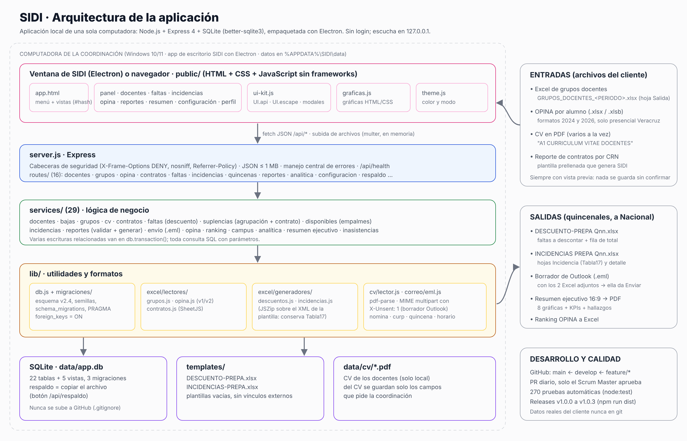
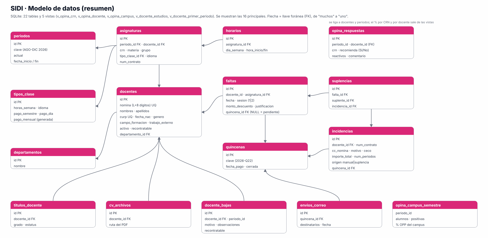

# SIDI · Manual técnico

**Para:** quien instala, mantiene o amplía SIDI · **Versión:** 1.0.3 del instalador (código 1.0.2: rama `develop`, commit `5b72c44`, igual a `main`) · **Fecha:** 27/11/2026

Este manual describe cómo está construido SIDI, cómo se instala y despliega, cómo se prueba y cómo se mantiene. La documentación de diseño completa está en `context/` (requerimientos, backlog, arquitectura, modelo de datos, UI/UX, API y formatos de Excel); este manual la resume y la actualiza con lo que quedó implementado.

**Soporte:** Equipo SIDI: Matías Hernández Garrido (desarrollador backend) y Calixto Isaac Galeana Medrano (Scrum Master).

---

## Contenido

1. Visión general y stack
2. Estructura del repositorio
3. Instalación para desarrollo
4. Configuración (`.env`)
5. Base de datos
6. Backend: rutas, servicios y utilidades
7. API REST
8. Frontend
9. Lectores y generadores de archivos
10. Pruebas
11. Despliegue en la computadora de la coordinación
12. Respaldo y restauración
13. Seguridad
14. Flujo de trabajo con Git
15. Tareas de mantenimiento frecuentes
16. Solución de problemas

---

## 1. Visión general y stack

SIDI es una aplicación web **local** de un solo usuario: un proceso Node.js sirve la API REST y los archivos estáticos, y guarda todo en un archivo SQLite. No hay inicio de sesión; el servidor escucha solo en `127.0.0.1`.



| Componente | Versión (lockfile) | Uso |
|---|---|---|
| Node.js | ≥ 20 (recomendado 22 LTS) | Ejecución en desarrollo y para generar el instalador |
| Electron | 42.11.18 (la descarga `scripts/empaquetar.js`) | Ventana de la app instalada; trae su propio Node, así que la computadora de la coordinación no necesita Node.js |
| Express | 4.22.3 | Servidor HTTP y rutas |
| better-sqlite3 | 12.11.1 | Base de datos SQLite (síncrona, una conexión) |
| xlsx (SheetJS) | 0.20.3, desde `cdn.sheetjs.com` | Leer Excel de grupos, OPINA (`.xlsx`/`.xlsb`) y contratos; escribir el ranking |
| jszip | 3.10.2 | Editar el XML de las plantillas de Nacional |
| pdf-parse | 2.4.5 | Leer el texto de los CV en PDF |
| multer | 2.5.0 | Subida de archivos (en memoria) |
| dotenv | 16.x | Variables de entorno |
| pdf-lib (dev) | 1.17.x | Generar CV ficticios para las pruebas |
| @electron/get, extract-zip, resedit, pe-library (dev) | — | Descargar Electron, ponerle ícono y versión al `.exe` al empaquetar |
| `bcryptjs`, `jsonwebtoken` | — | **Sin uso**, heredadas de la plantilla; pendientes de quitar |

Frontend: HTML + CSS + JavaScript sin frameworks ni compilación. Pruebas: `node:test`.

---

## 2. Estructura del repositorio

```
server.js                    Express: cabeceras, rutas /api, estáticos y errores
lib/
  db.js                      conexión única, PRAGMAs, migraciones, semillas
  migraciones/               001_inicial.sql, 002_indice_horarios.sql, 003_retro_sesion_cliente.sql
  rutas.js                   carpeta de datos: <proyecto>/data o SIDI_DATA_DIR (app instalada)
  semillas.js                tarifas, catálogos, periodos, quincenas, configuración
  nomina.js curp.js quincena.js horario.js antiguedad.js periodos.js nombres.js validar.js color.js
  textoSuplencia.js          texto "Sustituyó al docente…" de Nacional
  errores.js                 HttpError y manejarErrores
  subida.js                  multer con extensiones y límites
  analitica.js configuracion.js previews.js
  cv/lector.js cv/fechas.js  lector de CV (pdf-parse)
  correo/eml.js              borrador de Outlook (MIME con X-Unsent: 1)
  excel/lectores/            grupos.js, opina.js (v1/v2), contratos.js, comun.js
  excel/generadores/         descuentos.js, incidencias.js, plantillaXlsx.js, plantillaContratos.js
services/                    29 servicios de negocio (*Service.js)
routes/                      16 routers Express
public/
  app.html                   menú lateral + contenedor de vistas
  css/                       theme.css (tokens), base.css, app.css, sidi.css
  js/                        theme.js, ui-kit.js, sidi-comun.js, app.js, graficas.js y una vista por archivo
templates/                   DESCUENTO-PREPA.xlsx, INCIDENCIAS-PREPA.xlsx (vacías, sin vínculos externos)
electron/main.js             app de escritorio: una sola instancia, arranca server.js en 127.0.0.1 y un puerto libre, menú SIDI / Ver
installer/sidi.nsi           instalador NSIS por usuario (sin administrador) en %LOCALAPPDATA%\Programs\SIDI
build/                       icon.ico e icon.png de la app
scripts/
  empaquetar.js              npm run dist → dist/SIDI-Setup-<versión>.exe
  demo.js                    base de demostración data/demo.db + Excel ficticios en data/demo/
  comparar-reportes.js       compara los Excel generados con los originales Q16–Q20 (solo local)
  github/                    creación del tablero, issues y plantillas de GitHub
tests/                       38 archivos *.test.js + helpers/ (bd, cv, excel, escenario)
context/                     documentación de diseño (01 a 07, Sprints, User_Stories, tareas/)
data/                        app.db, cv/*.pdf, demo/ — ignorados por git
```

---

## 3. Instalación para desarrollo

```bash
git clone https://github.com/CalixtoIsaac/SIDI-Sistema-Integral-de-Informacion-Docente.git
cd SIDI-Sistema-Integral-de-Informacion-Docente
git checkout develop
npm install
cp .env.example .env          # Windows: copy .env.example .env
npm run dev                   # se reinicia al guardar cambios del servidor
```

Abre `http://localhost:3000`. La primera vez se crea `data/app.db` con el esquema y las semillas.

| Script | Para qué |
|---|---|
| `npm start` | Ejecución normal |
| `npm run dev` | Desarrollo (`node --watch`) |
| `npm test` | 270 pruebas (`node --test`), ≈ 12 s |
| `npm run dist` | Instalador de Windows `dist/SIDI-Setup-<versión>.exe` (en Windows, con NSIS instalado) |
| `node scripts/demo.js [--reiniciar]` | Crea `data/demo.db` con datos ficticios y Excel en `data/demo/` |
| `node scripts/comparar-reportes.js …` | Compara reportes generados con originales; imprime solo conteos, filas y CRN (nunca nombres ni nóminas) |

**Usar la base de demostración:**

```powershell
$env:DB_PATH="data/demo.db"; npm start      # PowerShell
Remove-Item Env:DB_PATH                     # volver a la base normal
```

```bash
DB_PATH=data/demo.db npm start              # bash
```

**Notas de instalación:**

- `better-sqlite3` descarga un binario precompilado; si `npm install` intenta compilarlo y falla, usa una versión LTS de Node.
- `xlsx` se descarga de `https://cdn.sheetjs.com/xlsx-0.20.3/xlsx-0.20.3.tgz`. En redes que bloquean ese dominio, `npm install` falla con 403. Solución: descargar el `.tgz` en otra red, guardarlo en `vendor/` y cambiar la dependencia a `"xlsx": "file:vendor/xlsx-0.20.3.tgz"`.
- Si el repositorio está dentro de OneDrive, pausa la sincronización mientras haces `git pull`; si no, Windows puede preguntar si borrar carpetas bloqueadas (responde **n**).
- Los cambios en `public/` no requieren reiniciar el servidor: recarga el navegador.

---

## 4. Configuración (`.env`)

| Variable | Valor por defecto | Uso |
|---|---|---|
| `PORT` | `3000` | Puerto HTTP. La app instalada usa `0` (el sistema da un puerto libre) |
| `HOST` | `127.0.0.1` | Dirección de escucha. `0.0.0.0` lo abre a la red local: **no lo hagas** sin agregar inicio de sesión |
| `NODE_ENV` | `development` | `production` en la instalación |
| `DB_PATH` | `<carpeta de datos>/app.db` | Ruta del archivo SQLite; la carpeta se crea si no existe |
| `SIDI_DATA_DIR` | `./data` | Carpeta de datos (`app.db` y `cv/`). Electron la fija en `%APPDATA%\SIDI\data` |

No hay secretos: SIDI no guarda contraseñas ni llaves de API.

---

## 5. Base de datos



- **Motor:** SQLite con `better-sqlite3`, una sola conexión (`lib/db.js`). `PRAGMA journal_mode = WAL` y `PRAGMA foreign_keys = ON`.
- **Esquema:** 22 tablas, 5 vistas (`v_opina_crn`, `v_opina_docente`, `v_opina_campus`, `v_docente_estudios`, `v_docente_primer_periodo`) y 14 índices. DDL completo y decisiones en `context/04_Modelo_Datos.md`.
- **Migraciones:** archivos `lib/migraciones/NNN_nombre.sql`, aplicados en orden al arrancar, cada uno en su propia transacción y registrado en `schema_migrations`. Para cambiar el esquema, **agrega** una migración nueva; nunca edites una ya publicada (las bases instaladas no la volverían a correr).
- **Semillas:** `lib/semillas.js` inserta tarifas, catálogos de Nacional, motivos de baja, periodos, quincenas del año y configuración. Son idempotentes (`INSERT OR IGNORE`) y las que el usuario puede borrar (como el % OPP del campus) se marcan para aplicarse una sola vez.
- **Convenciones:** tablas en plural y `snake_case`; fechas `TEXT` ISO `YYYY-MM-DD`; horas `HH:MM`; dinero `REAL` redondeado a 2 decimales en el servicio; booleanos `INTEGER 0/1`; JSON en `TEXT`.

Reglas de dominio que viven en el esquema:

| Regla | Implementación |
|---|---|
| Nómina única y canónica `L` + 8 dígitos | `docentes.nomina` UNIQUE; `lib/nomina.js` normaliza |
| Una falta por docente, CRN, día y sesión | `UNIQUE (docente_id, asignatura_id, fecha, sesion)`; `sesion` = 1 o 2 |
| Falta pendiente de reportar | `faltas.quincena_id IS NULL` (índice parcial `idx_faltas_pendientes`) |
| Tarifa mensual | Columna generada `pago_semestre / 4` |
| Baja con historial | `docente_bajas`; `docentes.recontratable` guarda la última |
| Contrato por CRN | `asignaturas.num_contrato` |
| Falta justificada | `faltas.justificacion` ∈ `ninguna`, `incapacidad_imss`, `cita_imss`, `viaje_escolar` (migración 003); `folio_imss` solo en las dos de IMSS |

---

## 6. Backend: rutas, servicios y utilidades

| Capa | Regla |
|---|---|
| `routes/` | Reciben la petición, validan la entrada y responden. **Sin SQL.** Errores con `HttpError(status, mensaje, code)` |
| `services/` | Lógica de negocio. Reciben `db` como primer parámetro (así las pruebas usan una base en memoria). Varias escrituras relacionadas van en `db.transaction()` |
| `lib/` | Funciones puras y formatos de archivo; sin estado |

Servicios principales:

| Servicio | Responsabilidad |
|---|---|
| `docentesService`, `filtrosDocentes`, `docentesEdicionService` | Tabla con los 12 campos, búsqueda multicampo, filtros, paginación, alta y edición |
| `bajaService` | Baja con motivo, observaciones, recontratable y periodo |
| `gruposService`, `cvService`, `contratosService`, `opinaService` | Importaciones con vista previa (`previewId`) y confirmación |
| `faltasService`, `descuentoService` | Faltas por CRN/día/sesión, siempre 8 horas = 1 día; motivo No justificada / Justificada (incapacidad IMSS, cita IMSS con folio, viaje escolar); tarifa; descuento manual |
| `suplenciaService`, `disponiblesService` | Pago del suplente, agrupación de días, contrato del suplente; docentes sin empalme |
| `incidenciasService` | Pagos adicionales, orden, copiar de la quincena anterior |
| `reporteService`, `quincenasService`, `envioService` | Validación y generación de los Excel, cierre de quincena, borrador `.eml` y bitácora |
| `rankingService`, `opinaConsultaService`, `opinaCampusService` | Ranking, comparativo, % OPP del campus |
| `analiticaService`, `resumenEjecutivoService`, `inasistenciasService` | Panel, resumen ejecutivo con conclusiones generadas, inasistencias por semestre |

**Formato de error de la API:** `{ "error": "mensaje en español", "code": "CODIGO", "details": [...] }`. Códigos frecuentes: `FILTRO_INVALIDO` (400), `TIPO_ARCHIVO` (422), `ARCHIVO_GRANDE`, `AVISOS_ROJOS` (400), `ArchivoNoReconocido` (422), 404 de recurso, 409 de duplicado.

---

## 7. API REST

Todas las rutas cuelgan de `/api` y responden JSON (salvo descargas). Especificación detallada en `context/06_Especificacion_API.md`.

### 7.1 Resumen de endpoints

| Módulo | Endpoints |
|---|---|
| Salud | `GET /api/health` |
| Docentes | `GET /docentes` (search, filtros, ordenar, orden, page, limit) · `GET /docentes/:id` · `/:id/resumen` · `/:id/contratos` · `/:id/opina` · `/:id/cv` · `/:id/bajas` · `POST /docentes` · `POST /docentes/alta-rapida` · `PUT /docentes/:id` · `PATCH /docentes/:id/estatus` · `POST /docentes/:id/titulos` · `POST /docentes/:id/asignaturas` · `GET /docentes/motivos-baja` · `POST /docentes/cv/preview` · `POST /docentes/cv/confirm` |
| Títulos y asignaturas | `PUT/DELETE /titulos/:id` · `PUT/DELETE /asignaturas/:id` |
| Importaciones | `POST /grupos/excel/preview` · `POST /grupos/excel/confirm` · `GET /grupos/importaciones` · `GET /contratos/plantilla` · `POST /contratos/preview` · `POST /contratos/confirm` · `GET /contratos/importaciones` |
| Faltas | `GET /faltas` · `GET /faltas/:id` · `POST /faltas/preview` · `POST /faltas` · `PUT/DELETE /faltas/:id` · `PUT/DELETE /faltas/:id/suplencia` · `POST /faltas/disponibles` · `GET /faltas/resumen-semestral` · `GET /faltas/resumen-quincena` |
| Incidencias | `GET/POST /incidencias` · `GET/PUT/DELETE /incidencias/:id` · `POST /incidencias/copiar` · `PATCH /incidencias/orden` |
| Quincenas y periodos | `GET /quincenas` · `GET /quincenas/actual` · `GET/PATCH /quincenas/:id` · `GET /periodos` · `PUT /periodos/:id` |
| Reportes | `GET /reportes/descuentos/validar` · `GET /reportes/descuentos` · `GET /reportes/incidencias/validar` · `GET /reportes/incidencias` · `GET /reportes/enviar/vista-previa` · `POST /reportes/enviar` · `GET /reportes/envios` |
| OPINA | `POST /opina/preview` · `POST /opina/confirm` · `GET /opina/ranking` · `GET /opina/ranking/excel` · `GET /opina/comparativo` · `GET /opina/importaciones` · `DELETE /opina/importaciones/:id` · `GET /opina/campus` · `PUT/DELETE /opina/campus/:periodoId` |
| Analítica | `GET /analitica/kpis` · `/opina` · `/distribucion-nivel` · `/perfil-docentes` · `/faltas-por-motivo` · `/cumpleanos-mes` · `/resumen-ejecutivo` · `/plantilla` |
| Catálogos y configuración | `GET /tipos-clase` · `PUT /tipos-clase/:id` · `GET/POST /catalogos` · `PUT/DELETE /catalogos/:id` · `GET/POST /departamentos` · `PUT/DELETE /departamentos/:id` · `GET/PUT /configuracion` |
| Sistema | `GET /respaldo` (descarga `SIDI-respaldo-AAAA-MM-DD.db`) |

### 7.2 Patrón de importación con vista previa

Toda importación tiene dos pasos: `POST …/preview` (multipart, campo `archivo` o `archivos`) lee el archivo, **no escribe** y devuelve un `previewId` con el resumen y los avisos; `POST …/confirm` con `{ previewId }` aplica los cambios en una transacción. Así la interfaz puede mostrar qué pasará antes de guardar.

### 7.3 Marcar el semestre actual (sin botón en la interfaz)

En la versión 1.0.3 no hay botón para cambiar el semestre actual. Mientras se agrega, se hace con la API.

**En la app instalada** (el puerto cambia en cada arranque): en SIDI, **Alt** → **Ver** → **Herramientas de desarrollo** → pestaña *Console*, y escribe:

```js
// 1. Ver los periodos y su id
await (await fetch('/api/periodos')).json()
// 2. Marcar el periodo con id 5 como actual (desmarca los demás)
await fetch('/api/periodos/5', { method: 'PUT', headers: { 'content-type': 'application/json' }, body: '{"actual": true}' })
```

**En desarrollo** (`npm start`, puerto 3000), desde PowerShell:

```powershell
# 1. Ver los periodos y su id
Invoke-RestMethod http://localhost:3000/api/periodos | ConvertTo-Json -Depth 4
# 2. Marcar el periodo con id 5 como actual (desmarca los demás)
Invoke-RestMethod -Method Put -Uri http://localhost:3000/api/periodos/5 -ContentType 'application/json' -Body '{"actual": true}'
```

Después, **Alt** → **Ver** → **Recargar**.

---

## 8. Frontend

- `app.html` carga los CSS y los módulos en orden; `theme.js` va en `<head>` para aplicar modo y color antes de pintar.
- **Navegación:** `app.js` define `VIEWS` (`panel`, `docentes`, `faltas`, `incidencias`, `opina`, `reportes`, `resumen`, `configuracion`, `perfil`) y navega por `location.hash` (por ejemplo `#docentes?ficha=12`). Vista por defecto: `panel`.
- **Cada vista es un módulo IIFE** que expone `mount(contenedor, parametros)`.
- **`ui-kit.js`:** `UI.api` (fetch JSON con errores en español), `UI.escape` (obligatorio para todo dato del usuario en HTML), `UI.toast`, `UI.confirm`, `UI.formModal`, iconos.
- **`graficas.js`:** barras y líneas en HTML/CSS/SVG, sin librerías; usan las variables del tema.
- **Tema:** `theme.css` define tokens; `theme.js` deriva `--primary-hover`, `--primary-soft`, `--ring`, `--primary-foreground` del color elegido y valida contraste ≥ 4.5:1. La base de datos (`tema.modo`, `tema.color`) es la fuente de verdad; `localStorage` (`sidi.tema`) es caché.
- **Resumen ejecutivo:** `resumen.js` dibuja 11 diapositivas 16:9 con `GET /analitica/resumen-ejecutivo` y exporta con `window.print()` y `@page { size: 13.333in 7.5in }`.

**Agregar una vista nueva:** crea `public/js/mi-vista.js` como IIFE con `mount()`, cárgalo en `app.html` antes de `app.js`, regístralo en `VIEWS` de `app.js` y agrega su enlace en el menú.

---

## 9. Lectores y generadores de archivos

| Archivo | Entrada / salida | Notas |
|---|---|---|
| `excel/lectores/grupos.js` | `GRUPOS_DOCENTES_<PERIODO>.xlsx`, hoja `Salida` | Agrupa filas por CRN (dos sesiones el mismo día), calcula horas/semana (fin + 1 min, redondeo a 0.5 h), sugiere idioma y tipo de clase, omite grupos configurados (`grupos.omitir_grupos`, por defecto F61,F62) |
| `excel/lectores/opina.js` | OPINA `.xlsx`/`.xlsb`, formatos 2024 (v1) y 2026 (v2) | Mapeo de columnas por alias; solo presencial y campus Veracruz; reporta filas descartadas |
| `excel/lectores/contratos.js` | Plantilla de SIDI o archivo propio con columnas CRN y Contrato | Vista previa con nuevos, cambian, sin contrato y avisos |
| `cv/lector.js` | CV en PDF, formato "A1 CURRICULUM VITAE DOCENTES" | Lee todas las páginas con texto; devuelve una **propuesta** con nivel de confianza; nunca escribe en la BD |
| `excel/generadores/descuentos.js` | `DESCUENTO-PREPA Qnn.xlsx` | Edita el XML de `templates/DESCUENTO-PREPA.xlsx`; una fila por falta y siempre fila de total `=SUM(K2:Kn)` |
| `excel/generadores/incidencias.js` | `INCIDENCIAS PREPA Qnn.xlsx` | Edita el XML: filas en `sheet1.xml`, ajusta el `ref` de `Tabla17`, hoja `detalle` con valores; borra `calcChain.xml` y marca `fullCalcOnLoad="1"` |
| `correo/eml.js` | Borrador `.eml` | MIME `multipart/mixed` con los 2 Excel en base64 y `X-Unsent: 1` |

**Si Nacional cambia el formato:** reemplaza la plantilla vacía en `templates/` (sin datos y sin `externalLinks/`), ajusta las columnas en el generador correspondiente y corre `npm test`: las pruebas de `reporte-descuentos` y `reporte-incidencias` revisan estructura, fórmulas y totales.

---

## 10. Pruebas

```bash
npm test                                  # todas
node --test tests/servicio-faltas.test.js # un archivo
node --test --test-reporter=spec          # salida legible
```

- 38 archivos, **270 pruebas**, todas con datos ficticios.
- `tests/helpers/bd.js` crea una base SQLite en memoria con las migraciones reales; `helpers/excel.js` arma Excel de prueba; `helpers/cv.js` genera CV en PDF con `pdf-lib`; `helpers/escenario.js` arma docentes, grupos y horarios.
- **Regla del equipo:** toda corrección de un error lleva una prueba que falla sin la corrección.

| Área | Pruebas |
|---|---|
| Base de datos, semillas y configuración | 52 |
| Reglas puras (CURP, nómina, quincena, horario, antigüedad) | 30 |
| Lectores (Excel de grupos, OPINA, CV) | 26 |
| Docentes (consulta, filtros, edición, bajas, importación) | 50 |
| Faltas, suplencias, disponibles e incidencias | 41 |
| Reportes de Nacional y correo | 24 |
| OPINA, panel y resumen ejecutivo | 47 |

**Prueba con datos reales (solo en la computadora del cliente):** `scripts/comparar-reportes.js` compara los Excel que genera SIDI con los originales Q16–Q20 y muestra solo conteos, número de fila y CRN. Los archivos reales nunca se suben al repositorio.

---

## 11. Despliegue en la computadora de la coordinación

**Instalador para Windows (recomendado).** Desde *Releases* del repositorio se publica `SIDI-Setup-<versión>.exe` (v1.0.0 a v1.0.3; la más reciente es la 1.0.3):

| Característica | Valor |
|---|---|
| Sistema | Windows 10 u 11 de 64 bits |
| Requiere Node.js | No: Electron trae su propio Node |
| Requiere administrador | No |
| Programa | `%LOCALAPPDATA%\Programs\SIDI`, con accesos directos en escritorio y menú Inicio |
| Datos | `%APPDATA%\SIDI\data` (`app.db` y `cv/`); se conservan al actualizar, reinstalar y desinstalar |
| Puerto | Libre, elegido al arrancar, solo en `127.0.0.1`; abrir SIDI dos veces enfoca la ventana existente |
| Firma digital | No (SmartScreen muestra advertencia: *Más información* → *Ejecutar de todas formas*) |
| Herramienta de empaquetado | Electron 42.11.18 + NSIS, con `npm run dist` (ver abajo); el Scrum Master lo genera a partir de `main` y lo publica en *Releases* |

**Generar el instalador** (en Windows, a partir de `main`):

```powershell
npm install
winget install NSIS.NSIS        # una sola vez
npm run dist                    # dist\SIDI-Setup-<versión>.exe
```

La versión del instalador sale de `package.json`. `scripts/empaquetar.js` descarga Electron, compila `better-sqlite3` para Electron, copia el código sin `data/` ni pruebas y llama a `makensis` con `installer/sidi.nsi`.

**Actualizar:** descargar el instalador nuevo y ejecutarlo; las migraciones se aplican solas al arrancar y los datos se conservan. Antes de actualizar, **haz un respaldo** (§12).

**Alternativa sin instalador:** instalar Node.js 22 LTS, copiar el repositorio, `npm install --omit=dev`, crear `.env` con `NODE_ENV=production` y un `DB_PATH` fuera de la carpeta del código, y crear un acceso directo a `npm start` y otro a `http://localhost:3000`.

**Lista de verificación después de instalar o actualizar:**

- [ ] SIDI abre en su ventana y el Panel carga sin errores (**Alt** → **Ver** → **Herramientas de desarrollo** → *Console*).
- [ ] En Faltas → Registrar falta aparece el motivo *Justificada* con la opción *Viaje escolar* (versión ≥ 1.0.2).
- [ ] Configuración muestra las tarifas vigentes.
- [ ] **Alt** → **SIDI** → **Abrir carpeta de datos** abre `%APPDATA%\SIDI\data` con `app.db`.
- [ ] El `.eml` de prueba abre como borrador en el Outlook de la coordinadora.

---

## 12. Respaldo y restauración

- **Respaldo en la app instalada:** **Alt** → **SIDI** → **Abrir carpeta de datos**, cerrar SIDI (**Alt** → **SIDI** → **Salir**) y copiar la carpeta `data` completa (`app.db` y `cv/`) a almacenamiento institucional, con la fecha en el nombre.
- **Respaldo por API (desarrollo):** `GET /api/respaldo` usa `db.backup()` (copia consistente aunque haya escrituras, incluye el WAL) y descarga `SIDI-respaldo-AAAA-MM-DD.db`. La copia temporal se borra al terminar la descarga.
- **Restaurar:** cerrar SIDI, renombrar el archivo actual (por ejemplo `app.db.anterior`), copiar el respaldo con el nombre `app.db` en la carpeta de datos y abrir SIDI. Borra también `app.db-wal` y `app.db-shm` si existen.
- El respaldo contiene datos personales: guárdalo solo en almacenamiento institucional.

---

## 13. Seguridad

| Control | Dónde |
|---|---|
| Escucha solo en `127.0.0.1` | `server.js` (`HOST`) |
| Cabeceras `X-Frame-Options: DENY`, `X-Content-Type-Options: nosniff`, `Referrer-Policy: same-origin`; sin `X-Powered-By` | `server.js` |
| JSON ≤ 1 MB; errores sin pila de llamadas | `server.js` |
| SQL siempre con parámetros | `services/` |
| `UI.escape` en todo dato pintado en HTML | `public/js/` |
| Extensiones y tamaño por carga; archivos en memoria | `lib/subida.js` |
| Minimización de datos del CV; observaciones de baja y comentarios fuera de panel y resumen | `cv/lector.js`, `resumenEjecutivoService` |
| Datos reales fuera de git | `.gitignore` (`data/*.db`, `data/cv/`, `data/demo/`) |

**Pendientes conocidos:** `npm audit` reporta `body-parser 1.20.8` (alta, GHSA-27r3-jxmh-p828); corregir con `npm audit fix` y publicar una versión nueva del instalador. Quitar `bcryptjs` y `jsonwebtoken`. Firmar el instalador.

---

## 14. Flujo de trabajo con Git

```
main      ← (fin de sprint, solo el Scrum Master)
develop   ← PR diarios
feature/hu-XX-descripcion, fix/descripcion   (desde develop)
```

- `main` y `develop` protegidas; `CODEOWNERS`: `@CalixtoIsaac` aprueba todo.
- Commits con Conventional Commits en español: `feat(faltas): …`, `fix(reportes): …`, `test(…)`, `docs(…)`, `refactor(…)`, `chore(…)`.
- Plantilla de PR en `.github/pull_request_template.md`: resumen, historia (`Refs #N`), cambios, evidencia y checklist. Si un PR depende de otro, decláralo en la descripción.
- Prohibido `push --force` a `main` y `develop`. Nunca subir archivos reales del cliente.

---

## 15. Tareas de mantenimiento frecuentes

| Tarea | Cómo |
|---|---|
| Cambiar una tarifa | Configuración → Tarifas (no altera faltas registradas) |
| Agregar un grupo a omitir (otro grupo en línea) | Configuración → Grupos que se omiten, o `grupos.omitir_grupos` |
| Cambiar destinatarios de Nacional | Configuración → Correo a Nacional |
| Iniciar semestre | Importar Excel de grupos, marcar el semestre actual (§7.3), subir contratos |
| Agregar una columna a la BD | Nueva migración `lib/migraciones/004_….sql` + prueba en `tests/db.test.js`; para cambiar un `CHECK`, reconstruir la tabla como en la 003 (respaldando antes las tablas hijas con `ON DELETE CASCADE`) |
| Probar con datos ficticios | `node scripts/demo.js --reiniciar` y `DB_PATH=data/demo.db` |
| Publicar versión | Subir `version` en `package.json`, PR de `develop` a `main`, etiqueta `vX.Y.Z`, `npm run dist`, *Release* con el `.exe` y notas |

---

## 16. Solución de problemas

| Síntoma | Causa probable | Solución |
|---|---|---|
| `npm install` → 403 en `cdn.sheetjs.com` | Red que bloquea el CDN | Instalar `xlsx` desde un `.tgz` local (§3) |
| `npm install` falla compilando `better-sqlite3` | Node no LTS o sin binario para tu versión | Usar Node 22 LTS |
| `EADDRINUSE :3000` | Otra instancia de SIDI abierta | Cerrarla o cambiar `PORT` |
| Pruebas fallan con "No se encontró el DDL" | Versión anterior a `c85ae64` con saltos de línea CRLF | Actualizar `develop` |
| Excel generado pide "actualizar vínculos" | Plantilla con `externalLinks/` | Usar la plantilla vacía del repositorio |
| Aviso "Suplencia sin contrato del suplente" en Reportes | No se capturó el contrato del suplente al asignarlo | Botón *Corregir* en Reportes y escribir el contrato (solo números) |
| SIDI no abre: "SIDI no pudo iniciar" | Base dañada o carpeta de datos sin permisos | El mensaje muestra la carpeta de datos; restaurar el último respaldo (§12) |
| Outlook no abre el `.eml` como borrador | Versión de Outlook | Usar *Usar mi programa de correo* (`mailto`) |
| Windows pregunta si borrar carpetas durante `git pull` | Repositorio dentro de OneDrive | Responder **n** y pausar la sincronización |
