# SIDI · Manual de usuario

**Para:** Coordinación de Docentes, Preparatoria Tecmilenio campus Veracruz · **Versión de SIDI:** 1.0.1 · **Fecha:** 26/11/2026

Este manual explica cómo usar SIDI día a día: consultar a los docentes, registrar faltas y suplencias, capturar pagos y descargar los reportes de Nacional. No necesitas conocimientos técnicos. Las imágenes usan **datos de demostración** (nombres y nóminas inventados).

---

## Contenido

1. Abrir SIDI y conocer la pantalla
2. Rutina de inicio de semestre
3. Rutina de cada quincena
4. Panel
5. Docentes
6. Faltas y suplencias
7. Incidencias (pagos adicionales)
8. Reportes de Nacional y envío por correo
9. OPINA
10. Resumen ejecutivo
11. Configuración
12. Perfil y apariencia
13. Respaldo de la información
14. Preguntas frecuentes y solución de problemas

---

## 1. Abrir SIDI y conocer la pantalla

1. Abre SIDI con el acceso directo del escritorio o del menú Inicio. Se abre directo en el **Panel**; no hay usuario ni contraseña.
2. A la izquierda está el **menú**: Panel, Docentes, Faltas, Incidencias, OPINA, Reportes y Configuración. Abajo, tu nombre lleva a **Perfil**.
3. Arriba está el **buscador**: escribe un nombre, CURP, nómina (con o sin `L0`) o CRN y presiona Enter para ir al docente.
4. El botón de luna/sol cambia entre modo claro y oscuro. El botón junto a "Panel" contrae el menú para ganar espacio.

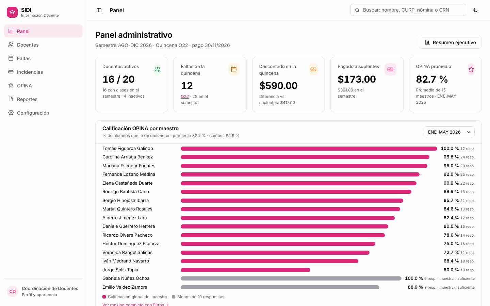

**Colores que siempre significan lo mismo:** verde = activo, gris = inactivo, rojo = falta o alerta, ámbar = pendiente o revisar.

> **Importante:** como SIDI no pide contraseña, bloquea tu sesión de Windows (tecla Windows + L) cada vez que te levantes de la computadora.

---

## 2. Rutina de inicio de semestre

Haz esto una vez, cuando recibas el Excel de grupos del semestre:

- [ ] **Semestre actual:** pide a soporte técnico que marque el semestre nuevo como actual (en esta versión no hay botón; ver *Manual técnico*, §7.3).
- [ ] **Docentes → Subir Excel de grupos:** carga `GRUPOS_DOCENTES_<PERIODO>.xlsx` (sección 5.4).
- [ ] **Configuración → Contratos por CRN:** descarga la plantilla, llénala con el contrato de cada CRN y súbela (sección 11.2).
- [ ] **Docentes → Subir CV (PDF):** carga los CV de los docentes nuevos (sección 5.5).
- [ ] Revisa la pestaña **Datos incompletos** en Docentes y completa lo que falte.
- [ ] **OPINA:** cuando llegue el archivo del semestre anterior, súbelo (sección 9.1).

## 3. Rutina de cada quincena

- [ ] Registra cada falta el día que ocurre o en cuanto te enteres (sección 6.1).
- [ ] Asigna el suplente de cada falta (sección 6.3).
- [ ] Captura los pagos adicionales: tutoreo, PAD, coach, talleres (sección 7).
- [ ] En **Reportes**, revisa los avisos, corrige lo que marque y descarga los dos Excel (sección 8).
- [ ] Envía a Nacional con **Abrir borrador de Outlook** (sección 8.3).
- [ ] **Cierra la quincena** (sección 8.4).
- [ ] Descarga un **respaldo** (sección 13).

---

## 4. Panel

El Panel es la primera pantalla. Muestra:

- **Indicadores de la quincena:** docentes activos, faltas, descontado, pagado a suplentes y OPINA promedio.
- **Calificación OPINA por maestro:** elige el semestre en la lista de la derecha. Las barras grises son docentes con menos de 10 respuestas (muestra insuficiente).
- Más abajo: docentes por nivel que imparten, nivel de estudios, género, faltas por motivo, cumpleaños del mes, avisos y últimas cargas.
- El botón **Resumen ejecutivo** abre la presentación para la directiva (sección 10).

---

## 5. Docentes

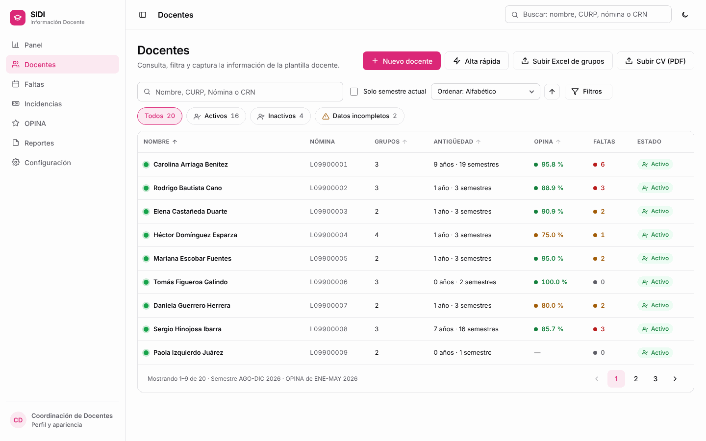

### 5.1 Buscar y filtrar

- Escribe en **Nombre, CURP, Nómina o CRN**: los resultados aparecen mientras escribes.
- Usa las pestañas **Todos · Activos · Inactivos · Datos incompletos**.
- Marca **Solo semestre actual** para ver solo a quienes dan clases este semestre.
- **Ordenar** por nombre, edad, antigüedad, grupos, nivel de estudios u OPINA; la flecha cambia el orden.
- **Filtros** abre los filtros detallados (género, nivel de estudios, campo de formación, antigüedad, si está estudiando, número de grupos, nivel que imparte, recontratable). Cada filtro activo aparece como una etiqueta que puedes quitar con la ×.
- Junto al nombre: punto verde o gris (activo o inactivo) y ⚠ si faltan datos. OPINA: verde ≥ 85 %, ámbar 70–84.9 %, rojo < 70 %.

### 5.2 Ver la ficha de un docente

Haz clic en cualquier parte de la fila. La ficha muestra nómina, nivel, campo de formación, OPINA, faltas del semestre, grupos, horas por semana, antigüedad y total mensual, con estas pestañas:

| Pestaña | Contenido |
|---|---|
| Asignaturas y horario | Una tarjeta por materia: CRN, grupo, horario, idioma, tipo de clase, tarifa diaria, tarifa mensual y contrato; vista semanal |
| Datos personales | CURP, fecha de nacimiento, edad, género, correo institucional |
| Formación y trayectoria | Títulos y su estatus, cursos, idiomas, experiencia; botón **Ver CV** |
| OPINA | Calificación por grupo, reactivos y comentarios de alumnos |
| Faltas y suplencias | Faltas del docente y suplencias que ha cubierto |
| Historial de bajas | Fechas, motivos, observaciones y si es recontratable |

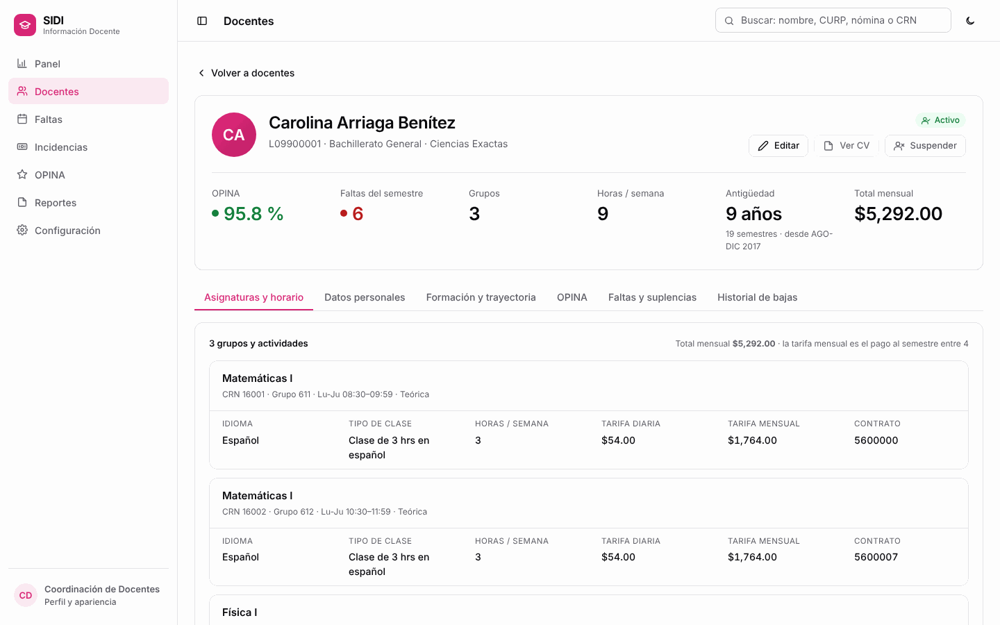

**‹ Volver a docentes** regresa a la misma página, pestaña y filtros donde estabas.

### 5.3 Agregar un docente

- **Nuevo docente:** formulario en 4 pasos (Datos personales, Formación, Laborales, Asignaturas). Los campos con * son obligatorios. La nómina acepta `3560330` o `L03560330`. Al escribir la CURP se llenan solas la fecha de nacimiento y el género.
- **Alta rápida:** solo nómina y nombre, para un suplente que necesitas registrar de inmediato. Completa sus datos después con **Editar**.

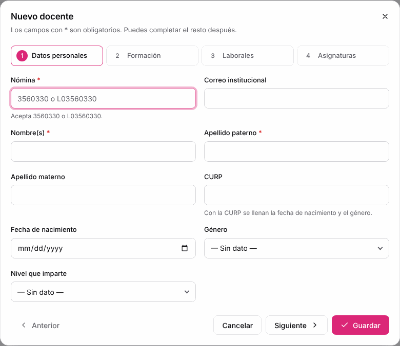

### 5.4 Subir el Excel de grupos del semestre

1. **Docentes → Subir Excel de grupos** y elige `GRUPOS_DOCENTES_<PERIODO>.xlsx`.
2. SIDI muestra el **periodo detectado** y cuántos docentes y grupos son nuevos, cuáles cambian de docente y quiénes ya no vienen.
3. Lee los avisos: grupos con idioma sugerido "Inglés", grupos **sin contrato**, grupos **F61/F62 en línea que se omiten**, docentes **no recontratables** o dados de baja que vuelven a aparecer.
4. Si todo está bien, **Confirmar e importar**. Si no, **Elegir otro archivo** o **Cancelar**: nada se guardó.

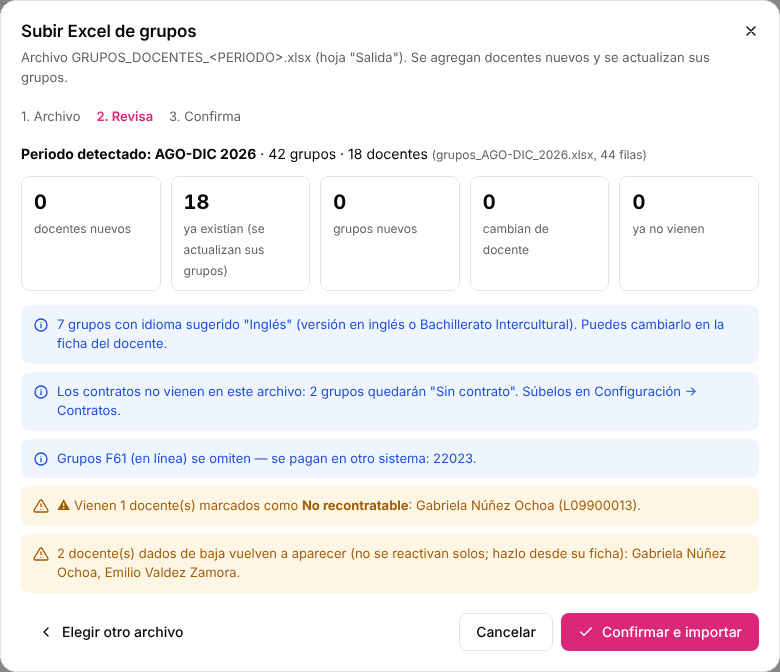

> Reimportar el mismo semestre actualiza los grupos, pero **no borra** lo que corregiste a mano.

### 5.5 Subir CV en PDF

1. **Docentes → Subir CV (PDF)** y elige uno o varios PDF (hasta 60 a la vez, 10 MB cada uno).
2. SIDI lee CURP, títulos con su estatus, cursos, idiomas y lugar de trabajo, y propone a qué docente pertenece cada CV.
3. Revisa la tabla: puedes corregir cualquier dato, elegir otro docente u omitir un CV.
4. Confirma. SIDI guarda solo lo necesario: **no** guarda domicilio, teléfono, RFC, estado civil ni correo personal.

Si un PDF es un escaneo sin texto, SIDI lo avisa y puedes capturar los datos a mano.

### 5.6 Dar de baja o reactivar

1. En la ficha, **Suspender**.
2. Elige el **motivo**, escribe las **observaciones** (obligatorias) y marca si es **recontratable**. SIDI sugiere la respuesta según el motivo.
3. **Dar de baja.** El docente queda inactivo (punto gris) y la baja queda en su historial.

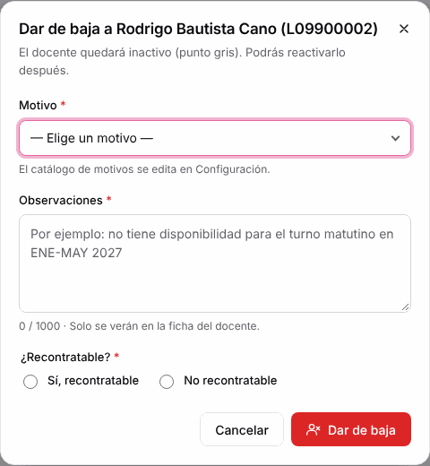

Para regresarlo: ficha → **Reactivar**. Si era "No recontratable", SIDI te pide confirmar. Las observaciones solo se ven en la ficha; nunca aparecen en el Panel ni en el Resumen ejecutivo.

---

## 6. Faltas y suplencias

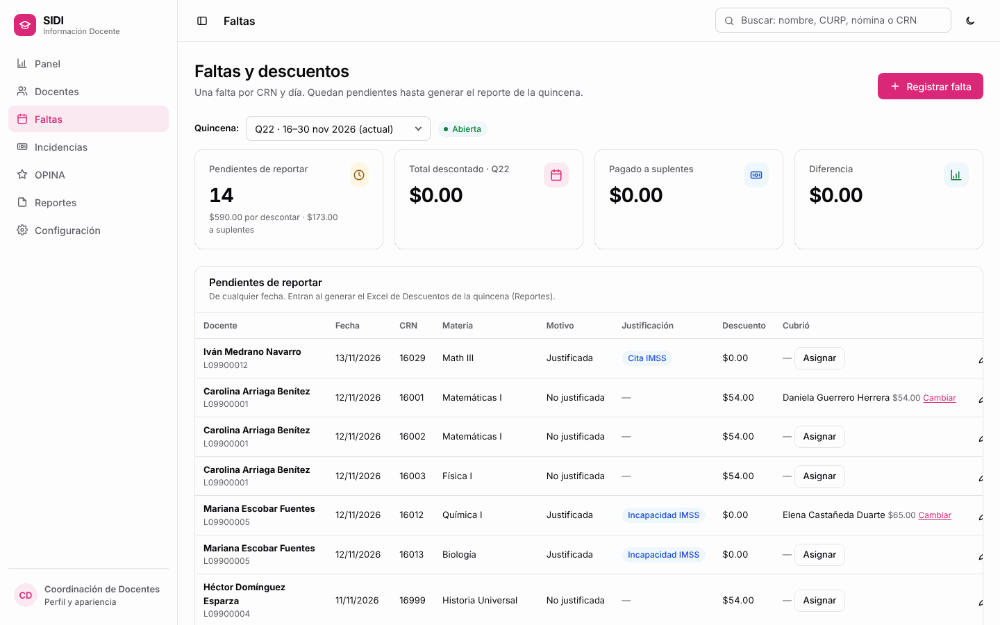

La pantalla muestra la quincena elegida con: pendientes de reportar, total descontado, pagado a suplentes y la diferencia. Una falta queda **pendiente** hasta que generas el reporte de su quincena.

### 6.1 Registrar una falta

1. **Registrar falta.**
2. **Docente:** escribe nombre, nómina, CURP o CRN y elígelo.
3. **Día(s):** elige la fecha y **Agregar día** si faltó varios días.
4. **CRN a los que faltó:** SIDI marca los grupos que el docente tiene ese día según su horario. Desmarca los que sí dio. Si un CRN tiene dos sesiones ese día y faltó a ambas, usa **+ 2ª sesión** (SIDI pide confirmar).
5. **Motivo, horas de la falta, cuenta de cargo** (automática según la materia) y **ticket** opcional.
6. **Justificación:** *Ninguna* (se descuenta), *Incapacidad IMSS* o *Cita IMSS* (no se descuenta y pide el folio).
7. Revisa la **vista previa**: fecha, CRN, tarifa, descuento y el comentario que irá en el Excel. Puedes cambiar el descuento de un día; queda marcado como editado.
8. **Guardar.**

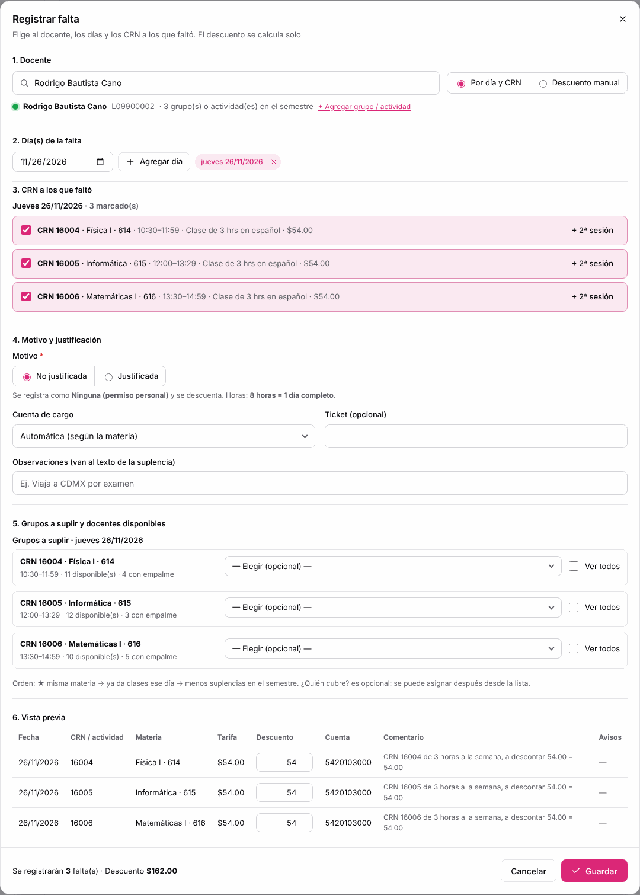

Si un CRN no tiene contrato capturado, SIDI te lo pide en ese momento y lo guarda para siempre.

### 6.2 Descuento manual

Para casos que no salen de la tabla de tarifas (por ejemplo, faltas injustificadas de un periodo largo), elige **Descuento manual** arriba a la derecha y captura el rango de fechas en texto, los días, las horas y el monto.

### 6.3 Asignar suplente

En la sección **5. Grupos a suplir y docentes disponibles** del mismo formulario, cada grupo muestra su horario y la lista de docentes **disponibles**: activos, sin clase que se empalme y sin falta ese día. El orden es:

1. ★ misma materia,
2. ya da clase ese día,
3. menos suplencias en el semestre.

Los no recontratables aparecen al final con ⚠. **Ver todos** incluye a quienes tienen empalme (SIDI pide confirmar). **+ Alta rápida** registra un suplente nuevo.

También puedes asignarlo después: en la lista de faltas, botón **Asignar** en la columna *Cubrió*.

Al asignar, SIDI crea el pago del suplente en Incidencias con el mismo monto, usa uno de **sus** contratos y agrupa los días del mismo grupo ("del 1 al 4 de septiembre, a pagar 4 días"). En faltas IMSS el suplente sí cobra.

### 6.4 Editar o eliminar

Desde la lista de faltas puedes **editar** (la suplencia se actualiza sola) o **eliminar** (pide confirmar). Las faltas de una quincena cerrada no se pueden modificar.

---

## 7. Incidencias (pagos adicionales)

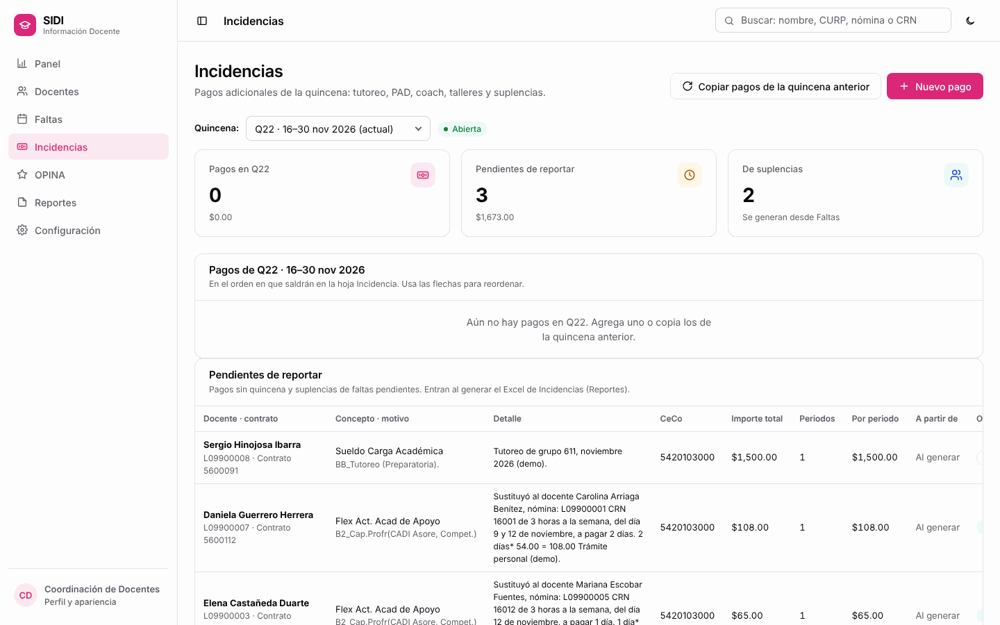

1. Elige la **Quincena**.
2. **Nuevo pago:** docente, contrato, concepto (cc-nómina), motivo, detalle, CeCo, importe total y número de periodos. SIDI calcula el importe por periodo.
3. **Copiar pagos de la quincena anterior** trae los pagos recurrentes para no capturarlos otra vez.
4. Usa las flechas para **ordenar** los pagos como deben salir en el Excel.

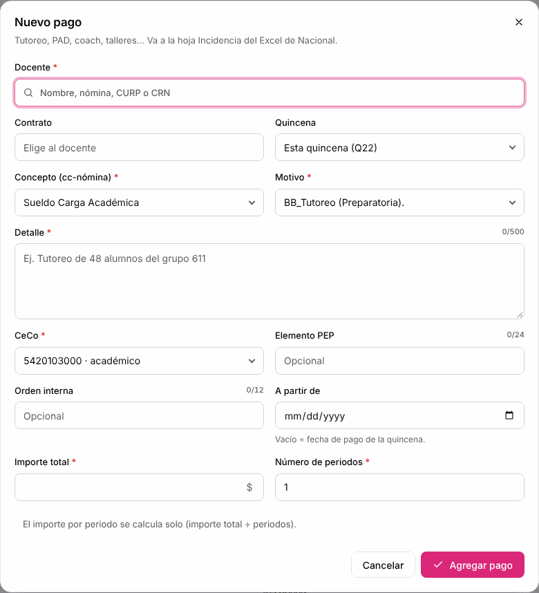

Los pagos a suplentes aparecen aquí con 🔗 y se editan desde **Faltas**.

---

## 8. Reportes de Nacional y envío por correo

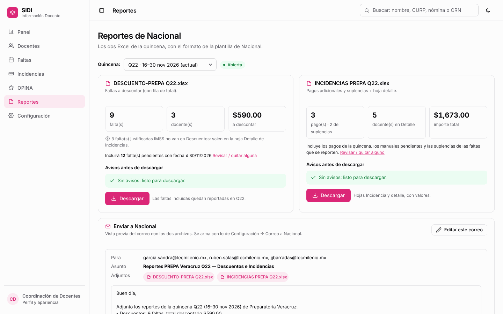

### 8.1 Revisar antes de descargar

1. Elige la **Quincena**.
2. Cada tarjeta muestra qué entra: faltas, docentes y monto de Descuentos; pagos, suplencias e importe de Incidencias.
3. **Revisar / quitar alguna** permite dejar una falta o un pago para la siguiente quincena.
4. **Avisos antes de descargar:** si hay algo que corregir (CRN sin contrato, contrato que ya no es del suplente…), haz clic en **Corregir** junto al aviso; se abre el registro exacto.

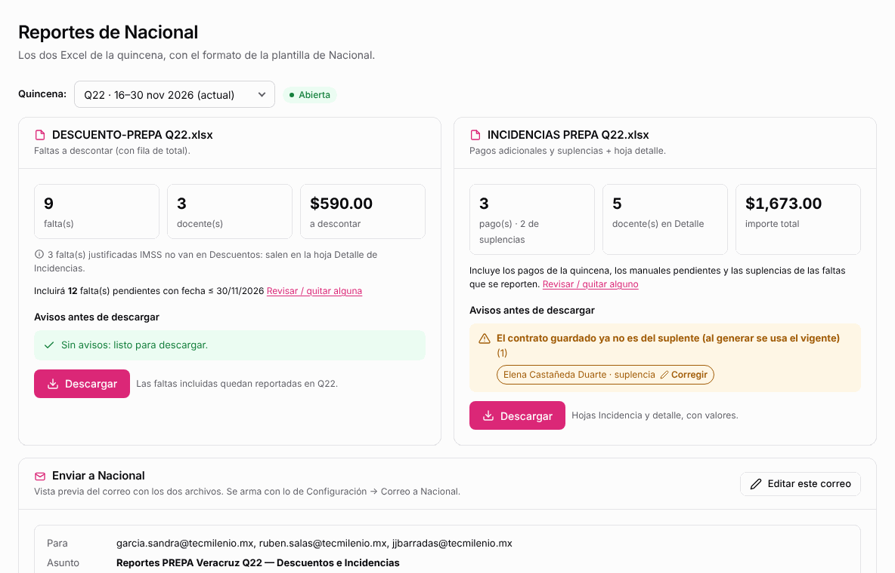

### 8.2 Descargar

- **Descargar** en la tarjeta de Descuentos → `DESCUENTO-PREPA Qnn.xlsx`.
- **Descargar** en la tarjeta de Incidencias → `INCIDENCIAS PREPA Qnn.xlsx` (hojas *Incidencia* y *detalle*).

Al descargar, las faltas y pagos incluidos quedan **reportados** en esa quincena. Los archivos tienen el mismo formato de la plantilla de Nacional.

### 8.3 Enviar a Nacional

1. En **Enviar a Nacional** revisa destinatarios, asunto, adjuntos y mensaje. **Editar este correo** cambia el texto solo para este envío.
2. **Abrir borrador de Outlook:** se descarga un archivo `.eml`; ábrelo y Outlook mostrará el correo listo con los dos Excel adjuntos. Revisa y presiona **Enviar**.
3. Si tu Outlook no abre el `.eml`, usa **Usar mi programa de correo**: se descargan los dos Excel y se abre un correo con destinatarios y texto; solo arrastra los dos archivos.

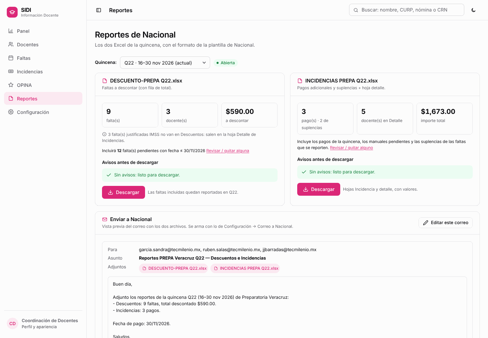

Con avisos en rojo no se puede enviar. Cada envío queda en el historial.

### 8.4 Cerrar la quincena

Cuando Nacional ya recibió los archivos, **Cerrar quincena**. Una quincena cerrada no admite cambios; si necesitas corregir algo, **Reabrir quincena**.

### 8.5 Inasistencias por semestre

Debajo de los reportes: número de faltas, profesores que faltaron, total descontado, faltas justificadas IMSS y faltas por motivo.

---

## 9. OPINA

### 9.1 Subir el archivo OPINA

1. **OPINA → Subir archivo OPINA (.xlsx / .xlsb)** (hasta 30 MB).
2. SIDI detecta el formato (2024 o 2026) y el semestre, y solo toma los grupos **presenciales del campus Veracruz**; muestra cuántas filas descartó y por qué.
3. Confirma. Si el semestre ya tenía OPINA, SIDI pregunta si quieres reemplazarlo.

### 9.2 Ranking completo

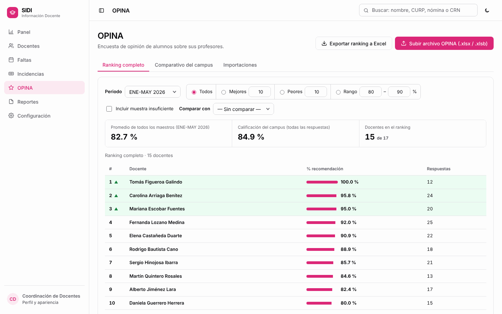

- Elige el **Periodo**, y **Todos**, **Mejores N**, **Peores N** o un **Rango** de %.
- **Incluir muestra insuficiente** muestra también a docentes con menos de 10 respuestas.
- **Comparar con** otro semestre agrega ▲/▼.
- Arriba: promedio de todos los maestros y calificación del campus.
- **Exportar ranking a Excel.** Haz clic en un docente para ver su pestaña OPINA.

### 9.3 Comparativo del campus

Pestaña **Comparativo del campus**: captura por semestre los alumnos y opiniones positivas de la fila *Preparatoria → Veracruz* del reporte institucional (**Capturar semestre**). SIDI calcula el % OPP y dibuja la tendencia.

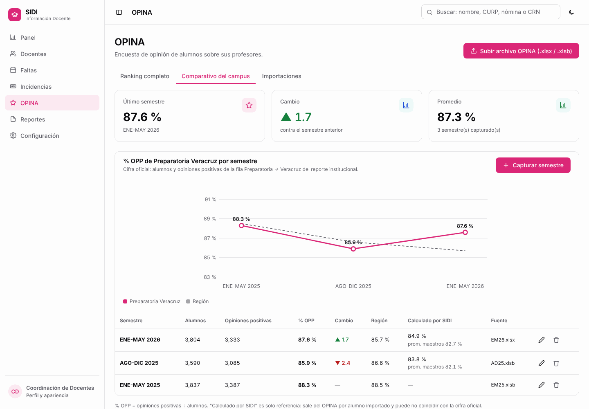

---

## 10. Resumen ejecutivo

Desde el Panel, **Resumen ejecutivo**. Es una presentación de 11 diapositivas armada con los datos de SIDI: portada, indicadores del semestre, 8 gráficas con su conclusión escrita y una diapositiva de hallazgos.

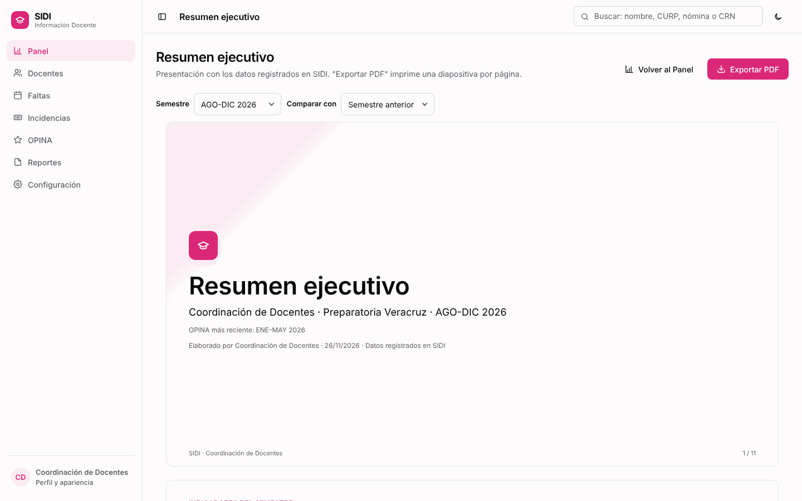

- Elige el **Semestre** y con qué semestre **Comparar**.
- **Exportar PDF** abre la impresión del navegador: elige *Guardar como PDF*. Sale una diapositiva por página.
- Si una sección no tiene datos, dice "Sin datos registrados"; nunca inventa información.

| Indicadores | % OPP del campus | Faltas por tipo | Hallazgos |
|---|---|---|---|
| 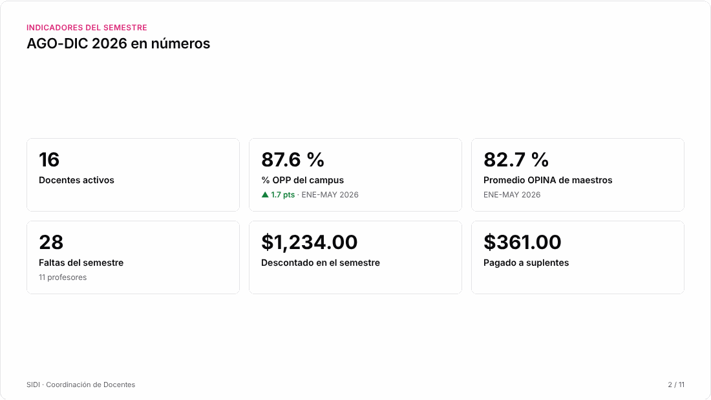 | 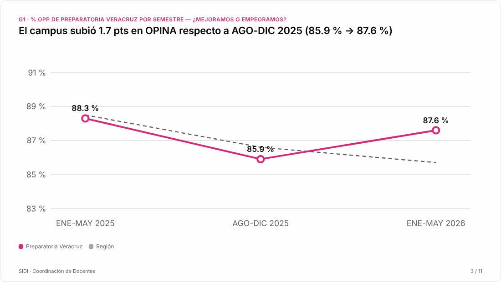 | 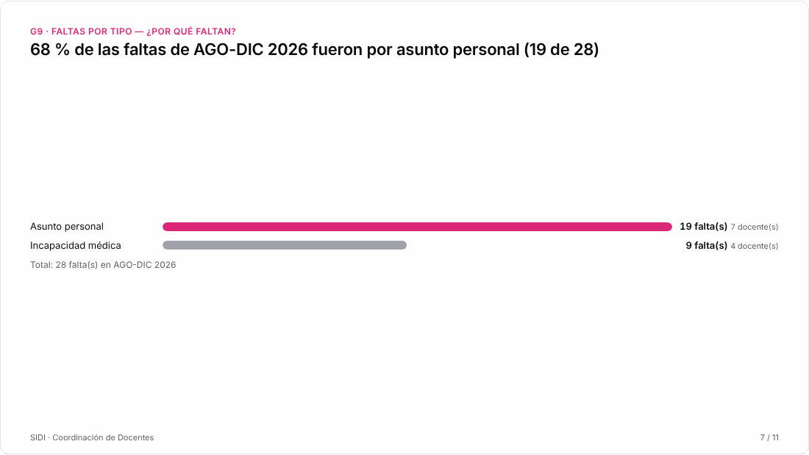 | 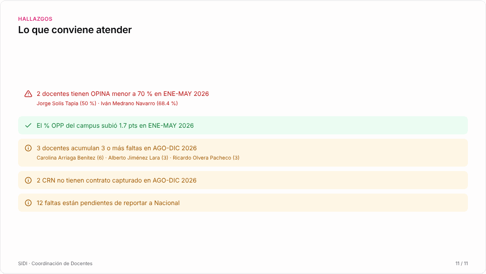 |

---

## 11. Configuración

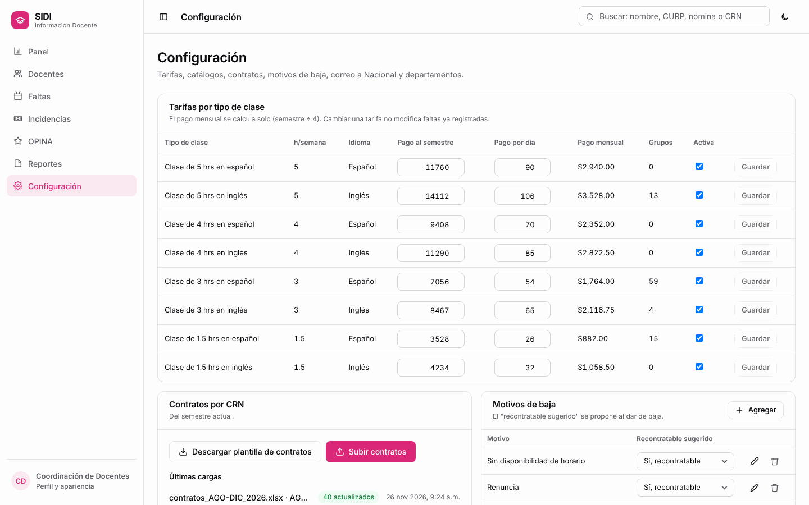

### 11.1 Tarifas por tipo de clase

Edita el **pago al semestre** y el **pago por día**; el pago mensual se calcula solo (semestre ÷ 4). **Guardar** en cada fila. Cambiar una tarifa **no** modifica las faltas ya registradas.

### 11.2 Contratos por CRN

1. **Descargar plantilla de contratos:** un Excel con CRN, materia, grupo, nómina y docente del semestre, y la columna *Contrato* vacía.
2. Llena la columna *Contrato* (o pide el reporte a RH; SIDI acepta cualquier archivo con columnas CRN y Contrato).
3. **Subir contratos:** revisa la vista previa (nuevos, cambian, sin contrato, avisos) y confirma.

### 11.3 Otros catálogos

Catálogos de Nacional (cc-nómina, motivos, CeCo), motivos de baja con su "recontratable sugerido", departamentos, grupos que se omiten (F61, F62) y parámetros de OPINA.

### 11.4 Correo a Nacional

Destinatarios (Para, CC, CCO separados por `;`), asunto y cuerpo. Puedes usar variables como `{quincena}`, `{periodo}`, `{fecha_pago}`, `{total_descontado}`, `{num_faltas}` y `{num_pagos}`.

---

## 12. Perfil y apariencia

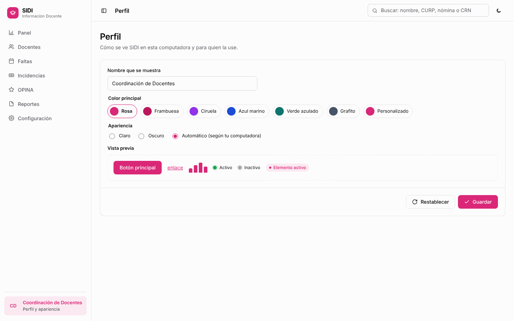

- **Nombre que se muestra** (aparece en el menú y en el Resumen ejecutivo).
- **Color principal:** Rosa (predeterminado), Frambuesa, Ciruela, Azul marino, Verde azulado, Grafito o Personalizado. SIDI rechaza colores que no se lean bien.
- **Apariencia:** Claro, Oscuro o Automático (según tu computadora).
- **Guardar** o **Restablecer**.

---

## 13. Respaldo de la información

Todo lo que capturas está en un solo archivo de base de datos. Para respaldarlo:

1. Con SIDI abierto, escribe en la barra de direcciones la misma dirección que ya aparece (por ejemplo `http://localhost:3000`) seguida de `/api/respaldo`, y presiona Enter.
2. Se descarga `SIDI-respaldo-AAAA-MM-DD.db`.
3. Guárdalo en una unidad institucional (OneDrive o carpeta de red de la escuela).

> **El respaldo contiene datos personales** (CURP, fechas de nacimiento, nóminas). No lo envíes por WhatsApp ni a correos personales.

Hazlo al menos al cerrar cada quincena.

---

## 14. Preguntas frecuentes y solución de problemas

| Situación | Qué hacer |
|---|---|
| Windows muestra "Windows protegió su PC" al instalar | El instalador no está firmado. *Más información* → *Ejecutar de todas formas* |
| No encuentro a un docente | Revisa la pestaña *Todos* (puede estar inactivo) y quita los filtros con **Limpiar filtros** |
| Un grupo dice "Sin contrato" | Sube los contratos (11.2) o captúralo cuando registres la primera falta de ese CRN |
| El descuento no es el que esperaba | Revisa el tipo de clase del CRN en la ficha (horas e idioma) y la tarifa en Configuración; puedes editar el monto de ese día |
| No aparece un docente como disponible para suplir | Tiene clase que se empalma, ya falta ese día o está inactivo; usa **Ver todos** |
| El botón Descargar muestra un error | Lee el aviso de la tarjeta y usa **Corregir** |
| Outlook no abre el `.eml` como borrador | Usa **Usar mi programa de correo** (8.3) |
| Me equivoqué en una falta de una quincena ya cerrada | **Reabrir quincena**, corrige, vuelve a descargar y cierra |
| El CV no se leyó bien | Corrige en la vista previa o captura el dato en **Editar** |
| La pantalla se ve sin estilos o en blanco | Recarga con F5; si sigue, cierra y abre SIDI de nuevo |

**Soporte:** Matías Hernández Garrido, desarrollador de SIDI · [al03035629@tecmilenio.mx](mailto:al03035629@tecmilenio.mx)
