# SIDI · Sistema Integral de Información Docente — Reporte técnico

**Universidad Tecmilenio** · Materia o certificado: **Metodologías Ágiles** · Profesor(a): José Manuel Martínez García

**Feria de Ingenierías AD2026** · Entrega final del proyecto · 26 de noviembre de 2026

**Cliente:** Coordinación de Docentes, Preparatoria Tecmilenio campus Veracruz

**Repositorio:** [github.com/CalixtoIsaac/SIDI-Sistema-Integral-de-Informacion-Docente](https://github.com/CalixtoIsaac/SIDI-Sistema-Integral-de-Informacion-Docente) · versión evaluada: rama `develop`, commit `5b72c44` (mismo código que `main`) · instalador **v1.0.3**

| Rol (Scrum) | Integrante |
|---|---|
| Product Owner | Saraí Cecilio Rascón |
| Scrum Master y frontend | Calixto Isaac Galeana Medrano |
| Backend | Matías Hernández Garrido |
| Base de datos y estructura | Uziel Armando García Duarte |

Integrante original: Sebastián Huesca Ramírez (frontend), quien salió del proyecto durante el desarrollo; el Scrum Master asumió el frontend.

---

## Resumen

**SIDI convierte el reporte quincenal de faltas y suplencias de la Coordinación de Docentes en un proceso calculado, validado y trazable, y reúne en una sola aplicación la información de los 47 docentes del campus.** Antes, la coordinadora juntaba datos de varios archivos, calculaba a mano el descuento de cada falta y llenaba dos Excel con formato fijo para Nacional. En los cinco reportes reales que nos entregó (quincenas Q16 a Q20) el equipo encontró **24 inconsistencias de captura o de formato**, 13 de ellas en montos o en la conciliación de dinero.

SIDI es una aplicación web local (Node.js + Express + SQLite) que se instala en Windows sin Node ni permisos de administrador. Importa el Excel de grupos, los CV en PDF, las encuestas OPINA y el reporte de contratos; calcula descuentos con la tarifa de cada tipo de clase; propone suplentes sin choque de horario; genera los dos Excel de Nacional sobre su plantilla original y prepara el correo en Outlook. Tiene **270 pruebas automáticas en verde**, responde en **menos de 6 ms** (p95) en búsquedas y genera ambos Excel en **menos de 12 ms**.

**Decisión que pedimos:** usar SIDI en paralelo al proceso manual en las quincenas **Q23 y Q24** (diciembre de 2026), medir el tiempo y los errores de ambos, y adoptarlo como proceso oficial en enero de 2027 si el resultado confirma la mejora (§7.4).

---

## Índice

1. Vinculación con la materia y el problema
2. Arquitectura de la aplicación
3. Funcionalidades implementadas y cómo se integran
4. Fundamentación cuantitativa de las decisiones de diseño
5. Pruebas: resultados, errores encontrados y cómo se corrigieron
6. Seguridad, privacidad y uso de datos
7. Innovación, impacto y resultados
8. Riesgos y responsabilidad profesional
9. Despliegue y optimizaciones
10. Reflexión: lecciones aprendidas
11. Áreas de mejora y siguientes iteraciones
12. Referencias

Anexo A. Cumplimiento de las rúbricas

---

## 1. Vinculación con la materia y el problema

**El proyecto aplica de punta a punta Scrum y el desarrollo de una aplicación web con base de datos relacional para un cliente real.** Es el proyecto final de la materia *Metodologías Ágiles*: acredita el uso de Scrum (roles de Product Owner y Scrum Master, backlog priorizado con historias de usuario, sprints con revisión del cliente, definición de terminado y flujo de trabajo con Git) y la construcción de un prototipo funcional para una necesidad real de la institución.

| Evidencia académica | Dónde está |
|---|---|
| Historias de usuario con criterios de aceptación, 27 historias, 134 puntos | `context/02_Product_Backlog.md` |
| 3 sprints de 15 días hábiles (03/11 → 24/11/2026), con revisión del cliente el 29/10 | `context/Sprints.md`, milestones de GitHub |
| Requerimientos funcionales (RF-01 a RF-29) y no funcionales (RNF-01 a RNF-08) | `context/01_Requerimientos_Tecnicos.md` |
| Modelo de datos, arquitectura, especificación de la API y formatos de Excel | `context/03` a `context/07` |
| Flujo Git: `main ← develop ← feature/*`, un PR diario por integrante, solo el Scrum Master fusiona | 45 PR fusionados, 134 commits en `develop` |

**El problema.** La Coordinación de Docentes de la Preparatoria campus Veracruz administra a 47 docentes de Bachillerato General y Bilingüe. Cada quincena envía a Nacional dos archivos de Excel con formato fijo: `DESCUENTO-PREPA Qnn.xlsx` (faltas a descontar) e `INCIDENCIAS PREPA Qnn.xlsx` (pagos adicionales y pagos a suplentes, con una hoja de conciliación). La información para llenarlos estaba repartida en el Excel de grupos del semestre, los CV en PDF y los contratos de cada grupo (CRN), y la consulta de perfiles docentes se hacía archivo por archivo.

---

## 2. Arquitectura de la aplicación

**SIDI es una sola aplicación Node.js que sirve la API y las páginas desde la computadora de la coordinación; en la versión instalada, Electron la abre en una ventana propia. Los datos viven en un archivo SQLite local y nunca salen a internet.**

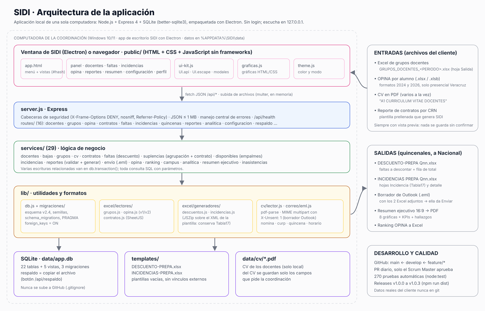
*Figura 1. Arquitectura por capas. Conclusión: cada capa tiene una responsabilidad (vista, ruta, regla de negocio, formato, almacenamiento), lo que permitió que cuatro personas trabajaran en paralelo con conflictos mínimos.*

| Capa | Tecnología | Responsabilidad | Tamaño |
|---|---|---|---|
| Vista | HTML, CSS y JavaScript sin frameworks (módulos IIFE), gráficas propias en HTML/CSS | 9 vistas, navegación por `#hash`, tema claro/oscuro y color elegible | 17 módulos JS (6,848 líneas), 1,231 de CSS y 98 de HTML |
| Servidor | Node.js + Express 4; Electron 42 en la app instalada | Cabeceras de seguridad, JSON ≤ 1 MB, errores centralizados; en la app, Electron arranca este servidor en `127.0.0.1` y un puerto libre | `server.js`, `electron/main.js` |
| Rutas | Express Router | Validan la entrada y responden; no tienen SQL | 16 archivos, 690 líneas |
| Servicios | JavaScript (CommonJS) | Reglas de negocio: descuentos, suplencias, empalmes, reportes, analítica | 29 archivos, 5,187 líneas |
| Utilidades | SheetJS, JSZip, pdf-parse | Lectores (Excel de grupos, OPINA, contratos, CV) y generadores (Excel de Nacional, correo `.eml`) | 29 archivos JS (3,062 líneas) y 3 migraciones SQL (428 líneas) |
| Datos | SQLite (`better-sqlite3`), modo WAL, llaves foráneas activas | 22 tablas, 5 vistas, 14 índices, migraciones versionadas | 1 archivo |

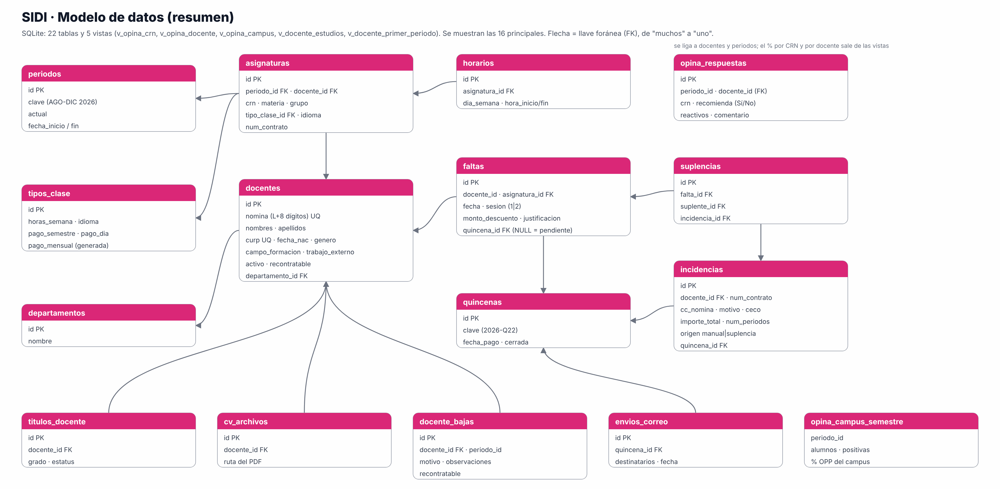
*Figura 2. Modelo de datos resumido. Conclusión: la falta se registra por CRN, día y sesión (así lo exige Nacional), y la suplencia une la falta con el pago al suplente, de modo que descuento y pago siempre cuadran.*

Decisiones de modelo que sostienen las reglas del cliente:

- **Nómina canónica** `L` + 8 dígitos; se acepta `3560330` o `L03560330` y cada formato de salida la escribe como la pide.
- **El contrato es por CRN** (`asignaturas.num_contrato`), porque Nacional pide un contrato distinto por grupo del mismo docente.
- **La falta queda "pendiente de reportar"** (`quincena_id` NULL) hasta que se genera el reporte; así nada se pierde entre quincenas.
- **El monto de la falta se guarda calculado**, para que un cambio de tarifa no altere faltas ya registradas.
- **La tarifa mensual es una columna generada** (`pago_semestre / 4`), no se captura.

---

## 3. Funcionalidades implementadas y cómo se integran

**Las 27 historias del backlog están implementadas en 9 vistas que comparten una sola base de datos: lo que se importa en una vista alimenta los cálculos de las demás.**

| Vista | Qué hace | Historias | Se integra con |
|---|---|---|---|
| Panel | KPIs de la quincena, OPINA por maestro, docentes por nivel y estudios, faltas por motivo, cumpleaños, avisos | HU-15 | Lee faltas, suplencias, OPINA y docentes |
| Docentes | Tabla paginada con pestañas Todos/Activos/Inactivos/Datos incompletos, búsqueda por nombre, CURP, nómina o CRN, filtros, ficha completa, alta, baja con motivo y "recontratable", carga de Excel de grupos y de CV | HU-01 a HU-07, HU-19, HU-20, HU-21 | Sus grupos y horarios alimentan Faltas; su OPINA, el Panel |
| Faltas | Registrar falta por día y CRN como No justificada (se descuenta) o Justificada (incapacidad IMSS, cita IMSS o viaje escolar: no se descuenta), siempre 8 horas = 1 día; 2ª sesión; descuento manual; grupos a suplir y docentes disponibles sin empalme; suplente con su contrato capturado a mano | HU-09, HU-10, HU-22 | Crea la incidencia del suplente; queda pendiente para Reportes |
| Incidencias | Pagos adicionales (tutoreo, PAD, coach, talleres), importe por periodo, copiar de la quincena anterior, orden del Excel | HU-11 | Entra al Excel de Incidencias |
| OPINA | Ranking completo con filtros (mejores/peores N, rango de %), comparativo entre semestres, % OPP del campus, exportar a Excel, importación con vista previa | HU-08, HU-16, HU-24 | Alimenta Panel, ficha y Resumen ejecutivo |
| Reportes | Avisos antes de descargar con botón *Corregir*, `DESCUENTO-PREPA Qnn.xlsx` e `INCIDENCIAS PREPA Qnn.xlsx`, cierre de quincena, borrador de Outlook con los dos adjuntos, inasistencias por semestre | HU-12, HU-13, HU-14, HU-25 | Toma las faltas e incidencias pendientes y las asigna a la quincena |
| Resumen ejecutivo | 11 diapositivas 16:9: portada, KPIs, 8 gráficas con titular-conclusión y hallazgos; exporta a PDF | HU-26 | Solo usa datos ya registrados |
| Configuración | Tarifas, catálogos de Nacional, motivos de baja, contratos por CRN (plantilla y carga), departamentos, correo a Nacional, grupos que se omiten | HU-18, HU-27 | Las tarifas definen el descuento de cada falta nueva |
| Perfil | Nombre, color principal con validación de contraste y modo claro/oscuro/automático | HU-17 | Aplica a todo el sistema |

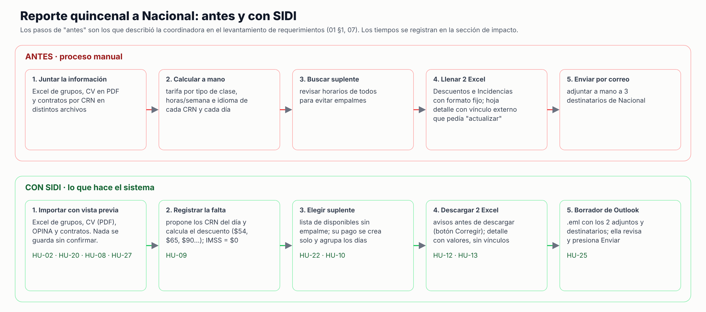
*Figura 3. Proceso quincenal. Conclusión: SIDI no cambia lo que Nacional recibe; cambia quién hace los cálculos y en qué momento se detectan los errores.*

### 3.1 El flujo principal, paso a paso

1. **Importar con vista previa.** Al subir el Excel de grupos, SIDI muestra cuántos docentes y grupos son nuevos, cuáles cambian, cuáles ya no vienen y qué avisos hay (grupos en línea F61/F62 que se omiten, docentes no recontratables, grupos sin contrato). Nada se guarda sin confirmar (Figura 4).
2. **Registrar la falta.** Al elegir docente y día, SIDI propone los CRN que el docente tiene ese día según su horario y calcula el descuento con la tarifa del tipo de clase ($54, $65, $90…). Toda falta cuenta como 8 horas = 1 día completo. Si es Justificada (incapacidad o cita del IMSS con folio, o viaje escolar), el descuento es $0 (Figuras 5 y 5b).
3. **Elegir suplente.** Para cada grupo a suplir, SIDI lista los docentes activos sin clase que se empalme ese día, ordenados por: misma materia → ya da clase ese día → menos suplencias en el semestre. Al elegir, se crea su pago en Incidencias y se agrupan los días del mismo CRN ("del 1 al 4 de septiembre, a pagar 4 días"). El contrato del suplente no viene en ningún archivo: SIDI propone el de sus grupos y la coordinadora puede escribir otro.
4. **Revisar avisos y descargar.** Reportes valida antes de generar (CRN sin contrato, contrato que ya no pertenece al suplente, faltas fuera de corte) y cada aviso abre el registro a corregir (Figura 6).
5. **Enviar.** SIDI arma un borrador de Outlook (`.eml`) con los dos Excel adjuntos y los tres destinatarios de Nacional; la coordinadora revisa y presiona *Enviar*.

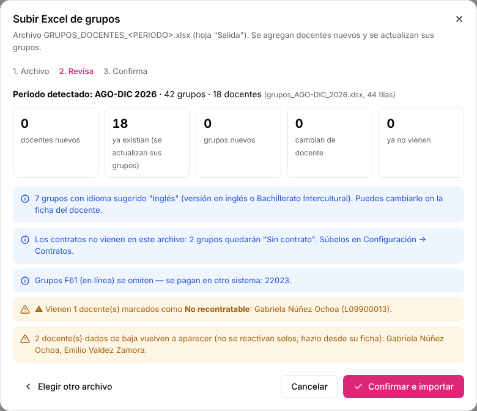
*Figura 4. Vista previa de la importación. Conclusión: la coordinadora ve el efecto de un archivo antes de que toque la base de datos.*

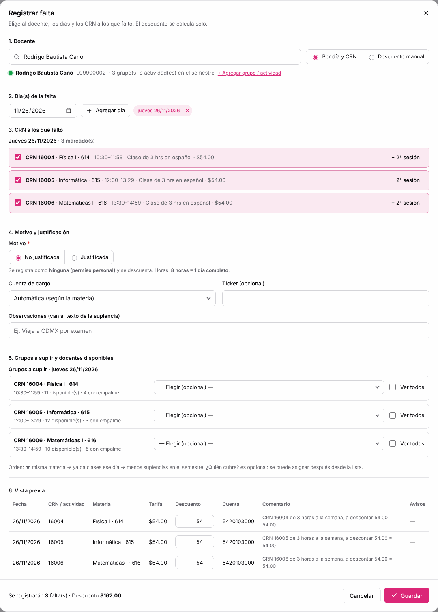
*Figura 5. Registrar falta con grupos a suplir y docentes disponibles. Conclusión: tres faltas, su descuento ($162.00) y los candidatos a suplir salen de una sola pantalla.*

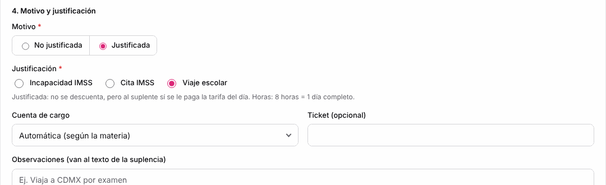
*Figura 5b. Motivo Justificada con la opción Viaje escolar, agregada en la versión 1.0.2 tras la sesión con la cliente. Conclusión: no se descuenta, pero el suplente sí cobra la tarifa del día.*

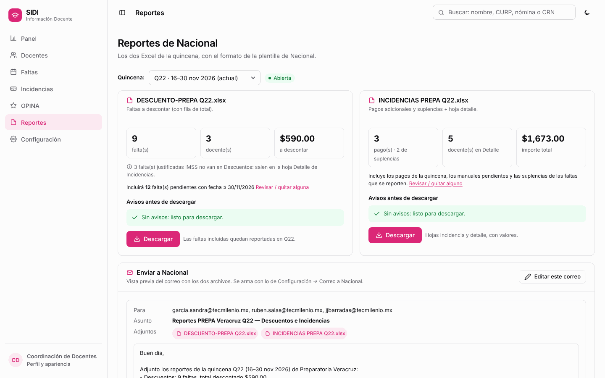
*Figura 6. Reportes de la quincena Q22. Conclusión: antes de descargar, SIDI resume qué entra (9 faltas, $590.00) y si hay algo que corregir.*

### 3.2 Archivos que genera

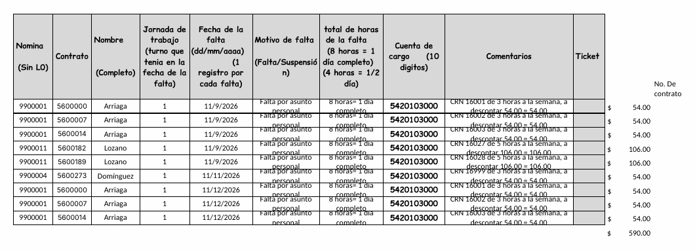
*Figura 7. `DESCUENTO-PREPA Q22.xlsx` generado con datos de demostración: una fila por CRN y día, comentario armado con horas y tarifa, y la fila de total que faltaba en 2 de los 5 originales.*

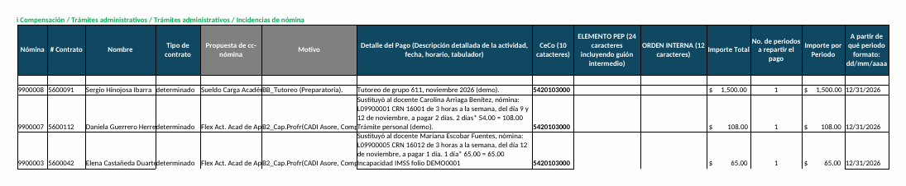
*Figura 7b. Hoja `Incidencia` generada: `Tabla17` redimensionada a las filas de la quincena, con la fórmula del importe por periodo.*

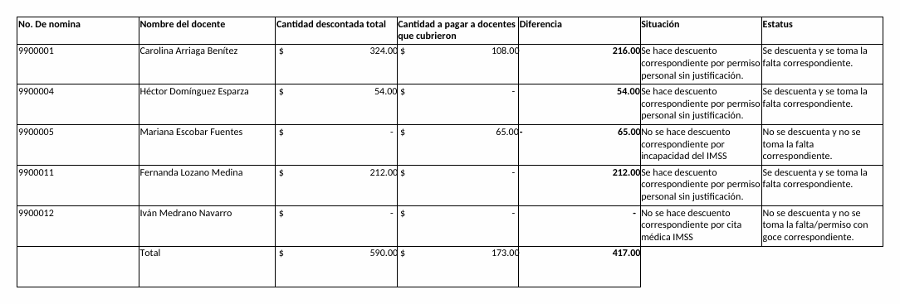
*Figura 8. Hoja `detalle` de Incidencias: descontado, pagado a suplentes y diferencia por docente. Conclusión: las faltas IMSS quedan con $0 descontado, el error que tenían Q17 y Q19.*

> Las figuras 7 y 8 se renderizaron con LibreOffice, que muestra las fechas en formato de EE. UU.; en Excel se ven como `dd/mm/aaaa`.

### 3.3 Diseño de la interfaz (UI/UX) y su justificación

| Decisión | Por qué |
|---|---|
| Se abre directo en el Panel, sin login | El cliente confirmó que no quiere iniciar sesión; se compensa escuchando solo en `127.0.0.1` (§6) |
| Máximo 2 clics para consultas frecuentes; búsqueda global arriba | RNF-01: usuaria sin conocimientos técnicos |
| Vista previa y confirmación en toda importación, baja o cierre de quincena | Un error en un archivo no debe llegar a la base de datos ni a Nacional |
| Color elegido solo en acentos; colores de estado fijos (verde activo, gris inactivo, rojo alerta, ámbar pendiente) | Formalidad institucional; el color no cambia el significado |
| Validación de contraste WCAG AA (4.5:1) al elegir color | Legibilidad en modo claro y oscuro |
| Tabla de docentes paginada según el alto de la ventana | Revisión del 19/11: la tabla debía verse completa sin scroll |
| Gráficas propias en HTML/CSS, sin librerías | Funcionan sin internet y toman el color del tema |
| Cada diapositiva del resumen ejecutivo lleva un titular con la conclusión | La directiva lee la conclusión antes que la gráfica |

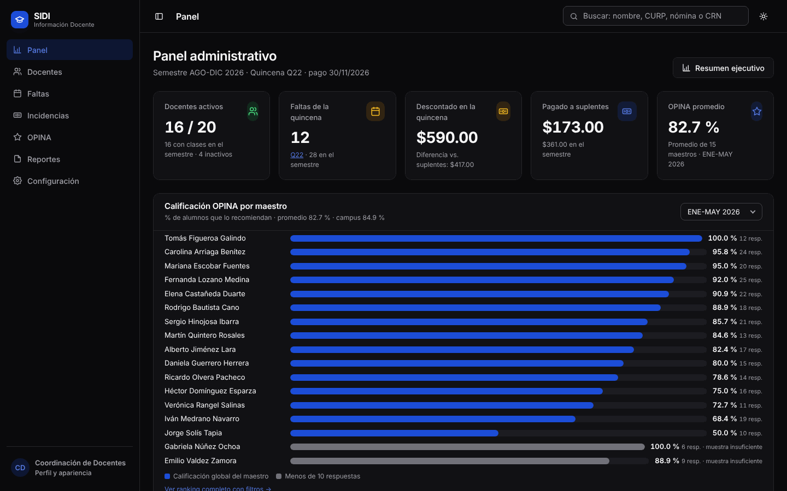
*Figura 9. El mismo Panel en modo oscuro y color azul marino. Conclusión: el tema cambia los acentos, no los colores de estado.*

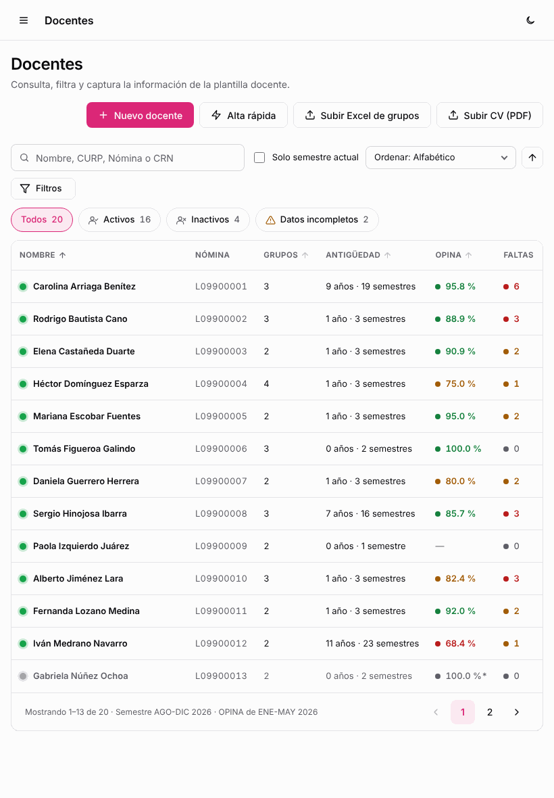
*Figura 9b. Docentes en una tableta (820 px de ancho). Conclusión: la tabla se adapta sin perder las columnas clave (RNF-06).*

---

## 4. Fundamentación cuantitativa de las decisiones de diseño

**Comparamos al menos dos alternativas en cada decisión de arquitectura con números propios, y elegimos la que cumple los requisitos con menos instalación, menos dependencias y menor riesgo para el formato de Nacional.**

Supuestos comunes: 1 usuaria a la vez en 1 computadora Windows; 47 docentes y unos 145 CRN por semestre; entre 3,716 y 4,033 respuestas OPINA por semestre (archivos reales de 2024–2026); 2 reportes por quincena (24 quincenas al año). Mediciones en un equipo Linux de pruebas (Node 22.23) con la base de demostración, sobre el commit `800e561` (v1.0.1); en la computadora de la coordinadora los tiempos absolutos pueden variar.

### 4.1 Base de datos

| Criterio (unidad) | **SQLite (elegida)** | MySQL / PostgreSQL | Seguir con Excel compartido |
|---|---|---|---|
| Servicios a instalar y mantener encendidos | **0** | 1 servidor de BD | 0 |
| Respaldo | **Copiar 1 archivo** (`/api/respaldo` usa `db.backup`) | Volcado con herramienta | Copiar varios archivos |
| Integridad referencial y transacciones | **Sí** | Sí | No |
| Búsqueda de docente, mediana / p95 (ms, n = 30) | **2.8 / 4.6** | no medido | manual |
| Tamaño de la base de demostración | **348 KB** (20 docentes, 3 semestres) | — | — |

**Cálculo de crecimiento.** Importamos un OPINA de 4,000 filas sobre la base de demostración: se guardaron 3,972 respuestas válidas y la base pasó de 348 KB a 888 KB, es decir **≈ 0.54 MB por semestre de OPINA** (≈ 139 bytes por respuesta). A 2 semestres por año, 10 años de uso suman ≈ 20 × 0.54 ≈ **11 MB**. *Incertidumbre:* los comentarios de alumnos varían en longitud; con el doble de texto el total seguiría por debajo de 25 MB. *Límite:* SQLite atiende bien a un solo usuario que escribe; si la coordinación quisiera varios usuarios en red editando a la vez, habría que migrar a un servidor de BD (§11).

### 4.2 Generación de los Excel de Nacional

| Criterio | **Editar el XML de la plantilla con JSZip (elegida)** | Reconstruir el libro con una librería de Excel | Llenar a mano (línea base) |
|---|---|---|---|
| Conserva `Tabla17`, sus fórmulas estructuradas y estilos | **Sí, por construcción** (se edita el mismo XML) | Riesgo de perderlos al reescribir el libro (documentado por el equipo en `03_Arquitectura` §1) | Sí, pero mal dimensionada en **5 de 5** originales |
| Vínculos externos al abrir | **0** (verificado: el archivo no contiene `externalLinks/`) | 0 | Pedía "actualizar vínculos" |
| Tiempo para generar, mediana (ms, n = 5) | **6.8** Descuentos · **9.1** Incidencias | no medido | ≈ 1 semana por quincena (estimación de la coordinadora) |
| Dependencias nuevas | **0** (JSZip ya estaba) | +1 | 0 |

*Decisión:* el formato de Nacional no se puede modificar, así que se eligió la opción que no reescribe nada que no haga falta. El documento de arquitectura planeaba ExcelJS para Descuentos; al implementarlo se usó la misma técnica de JSZip para ambos archivos, con una dependencia menos.

### 4.3 Envío a Nacional

| Criterio | **Borrador de Outlook `.eml` (elegida)** | Envío directo por SMTP | Microsoft Graph con OAuth |
|---|---|---|---|
| Contraseñas guardadas en SIDI | **0** | 1 | 0 (token) |
| Trámites con TI de la institución | **0** | Habilitar SMTP AUTH | Registrar una aplicación |
| Dependencias nuevas | **0** | 1 (Nodemailer) | ≥ 1 |
| Acciones de la coordinadora | 2 (generar borrador, *Enviar*) | 1 | 1 |
| Vigencia | Indefinida | Exchange Online desactivará por defecto la autenticación básica de SMTP a finales de diciembre de 2026 y anunciará en 2027 la fecha final de retiro ([Microsoft](https://techcommunity.microsoft.com/blog/exchange/updated-exchange-online-smtp-auth-basic-authentication-deprecation-timeline/4489835)) | Indefinida |

*Decisión:* un clic más a cambio de no guardar contraseñas ni depender de TI. Si la prueba en la computadora de la coordinadora falla, existe el respaldo `mailto:` con los dos archivos descargados.

### 4.4 Regla de cálculo del descuento

La tarifa por día sale de **horas por semana + idioma** del CRN (por ejemplo, 3 h en español = $54; 3 h en inglés = $65; 5 h en español = $90). Validamos la regla contra los 43 CRN cobrados en Q16–Q20: **coincide en 41 de 43 (95.3 %)**. Los 2 que no coinciden no son error de la regla: uno pertenece a otro docente en el Excel de grupos y el otro se cobró como 3 h siendo de 1.5 h. *Por eso* el tipo de clase es una sugerencia editable y un monto editado queda marcado.

### 4.5 Requisitos de rendimiento: meta vs. medición

| Requisito | Meta | Medido (mediana / p95) | Margen |
|---|---|---|---|
| RNF-02 Búsquedas y filtros | < 500 ms | Nombre 2.8 / 4.6 ms · nómina sin `L0` 3.2 / 5.4 ms · CRN 3.4 / 4.9 ms · filtros combinados 2.6 / 3.4 ms | > 90 veces |
| RNF-02 Importar un OPINA de ~4,000 filas | < 10 s | Vista previa 288 / 349 ms (n = 5) · guardar 28 ms | > 25 veces |
| Excel de grupos (44 filas): vista previa | — | 11.8 / 15.3 ms (n = 10) | — |
| Resumen ejecutivo completo | — | 6.3 / 7.1 ms · con 3,972 respuestas: 15.9 ms | — |

*Límite de la medición:* la base de demostración tiene 20 docentes, no 47. Las consultas recorren tablas pequeñas e indexadas, por lo que esperamos que el tiempo crezca de forma aproximadamente lineal y siga en el orden de milisegundos; **es una estimación**, no una medición con la plantilla real.

---

## 5. Pruebas: resultados, errores encontrados y cómo se corrigieron

**La versión evaluada pasa 270 de 270 pruebas automáticas; cada error que encontramos durante el desarrollo quedó con una prueba que lo reproduce, para que no regrese.**

### 5.1 Estrategia

| Tipo de prueba | Cómo se hizo | Resultado |
|---|---|---|
| Unitarias y de servicio | `node:test` con bases SQLite en memoria y archivos ficticios (CV en PDF generados, Excel de grupos y OPINA anonimizados) | **270 / 270** en 12 s |
| Punta a punta por HTTP | Base de demostración (`scripts/demo.js`): 20 docentes, 42 grupos, 494 respuestas OPINA, 28 faltas, 7 suplencias | Todas las vistas cargan; Excel generados y abiertos |
| Fidelidad de formato | Excel generados abiertos y comparados con la plantilla; script `scripts/comparar-reportes.js` para comparar contra los originales Q16–Q20 en la computadora del cliente | Estructura correcta (Tabla17 `A2:N6`, fila de total, sin vínculos). La comparación con los originales Q16–Q20 la hace la Product Owner en la computadora que tiene los archivos reales, que no salen de ahí |
| Seguridad | Pruebas manuales de inyección SQL, XSS, tipo y tamaño de archivo, JSON inválido, cabeceras y dirección de escucha (§6) | Todas bloqueadas |
| Usabilidad | Revisión de vistas con el cliente (29/10) y revisión grupal (19/11) | Diseño aprobado; 7 historias nuevas y rediseño de Docentes |
| Rendimiento y escala | Mediciones repetidas (§4.5) y OPINA de 4,000 filas | Dentro de metas |

**Prueba técnica del borrador de Outlook (26/11/2026).** Generamos el correo de la quincena Q22 desde la base de demostración y lo validamos con el analizador MIME de la biblioteca estándar de Python: 0 defectos, encabezado `X-Unsent: 1` (Outlook lo abre como borrador), los 3 destinatarios de Nacional, el asunto y el cuerpo con las variables resueltas, y los 2 Excel adjuntos, que abren sin errores. La apertura en el Outlook de la coordinadora queda para la puesta en marcha (Q23); si su versión no lo abre como borrador, SIDI tiene el respaldo *Usar mi programa de correo*.

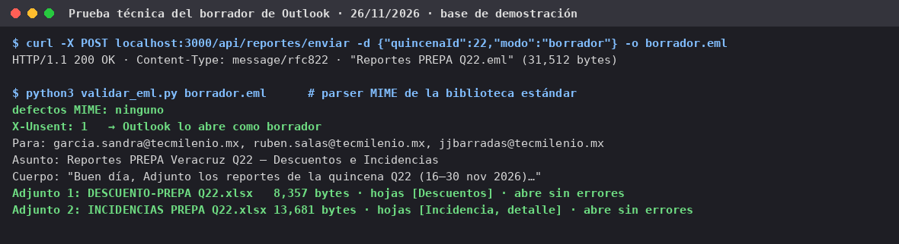
*Figura 10b. Validación del borrador `.eml` generado por SIDI.*

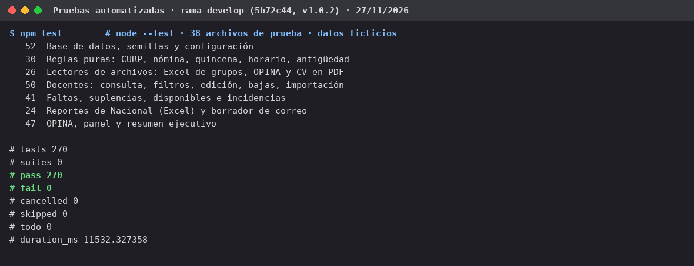
*Figura 10. 270 pruebas en 38 archivos, agrupadas por área. Conclusión: las reglas que mueven dinero (faltas, suplencias, reportes) tienen 65 pruebas.*

El número de pruebas creció con el proyecto: 111 al 12/11, 258 en la revisión de cierre del 19/11, 267 en la versión 1.0.1 y 270 en la 1.0.2.

### 5.2 Errores encontrados y su corrección

Para cada error volvimos a la versión anterior a la corrección, corrimos la prueba que lo detecta y tomamos la captura del fallo; después corrimos la misma prueba con la corrección. Las capturas "antes/después" de este apartado son esas ejecuciones.

**E1 · Las pruebas no encontraban el esquema en Windows (10/11/2026).**

*Síntoma:* en las computadoras con Windows, 10 de 10 pruebas de importación fallaban con "No se encontró el DDL en 04_Modelo_Datos.md". *Causa:* Git guardó el documento con saltos de línea `CRLF` y la expresión regular esperaba solo `\n`. *Acción:* la expresión acepta `\r?\n` (commit `c85ae64`). *Lección:* probar en el sistema operativo del cliente, no solo en el del desarrollador.

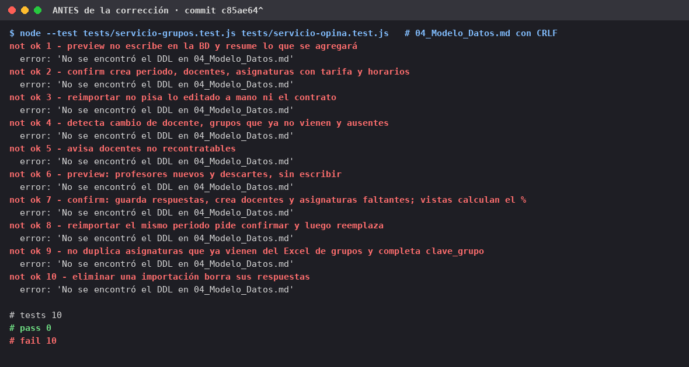
*E1 · antes de la corrección: 0 de 10 pruebas pasan.*

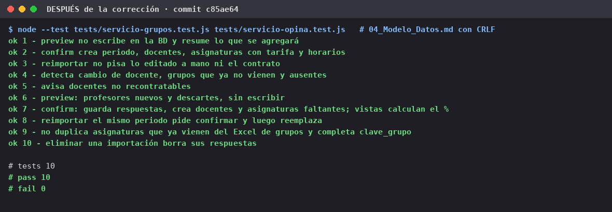
*E1 · después de la corrección: 10 de 10.*

**E2 · Una baja quedaba en el semestre equivocado (12/11/2026).**

*Síntoma:* al importar el Excel de grupos de un semestre que no es el actual y dar de baja a los ausentes, la baja se registraba en el semestre actual. *Causa:* el servicio de bajas siempre tomaba el periodo actual. *Acción:* el servicio recibe el periodo del archivo importado; la baja manual desde la ficha sigue usando el actual (commit `7884e56`, 2 pruebas nuevas).

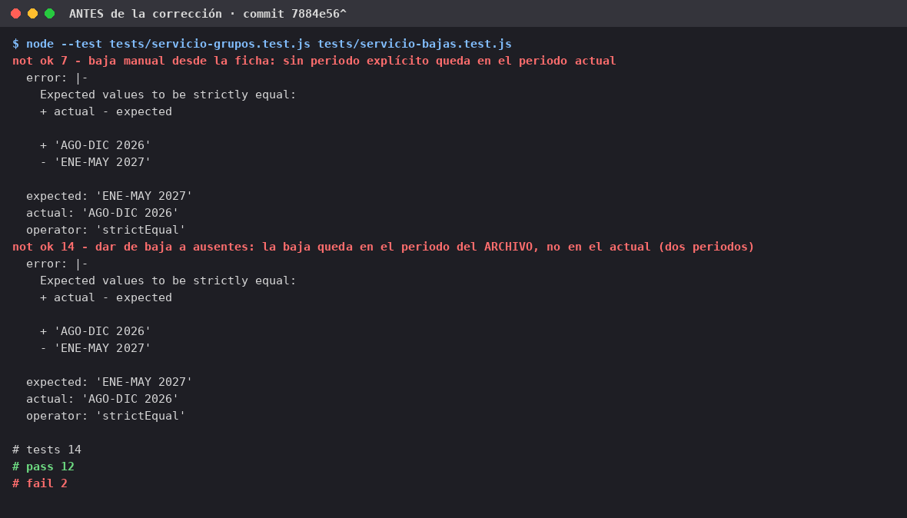
*E2 · antes: la baja queda en AGO-DIC 2026 en lugar de ENE-MAY 2027.*

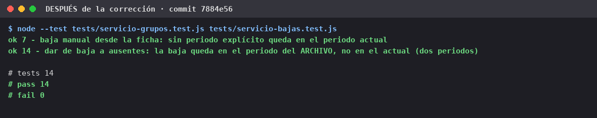
*E2 · después: 14 de 14.*

**E3 · El texto de pago del suplente multiplicaba de más y no se podía editar el monto de un solo día (18/11/2026, reportado por el Scrum Master).**

*Síntoma:* en una suplencia de descuento manual, el texto decía "14 días* 3183.74 = 44572.36" aunque el importe real era $3,183.74; y un monto editado se aplicaba a todo el CRN, no al día. *Causa:* el texto usaba el importe total como pago por día; el monto editado solo aceptaba la clave del CRN. *Acción:* pago por día = importe ÷ días ("14 días* 227.41 = 3183.74"); el monto acepta claves por día y por sesión, compatibles con las anteriores (commit `1d8e253`). El importe pagado nunca estuvo mal; el error era del texto que lee Nacional.

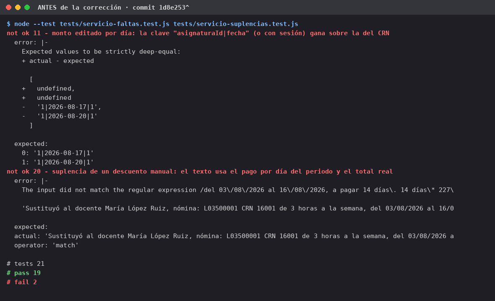
*E3 · antes: 2 pruebas fallan.*

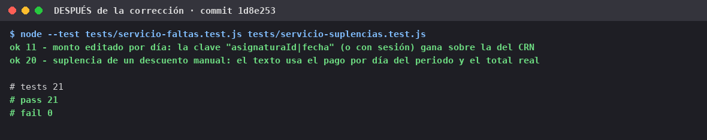
*E3 · después: 21 de 21.*

**E4 · Lo que la coordinadora borraba del % OPP del campus regresaba al reiniciar (18/11/2026).**

*Síntoma:* las cifras iniciales del % OPP se volvían a insertar cada vez que arrancaba el servidor. *Causa:* la semilla no registraba que ya se había aplicado. *Acción:* la semilla se aplica una sola vez y queda marcada (commit `67e9068`).

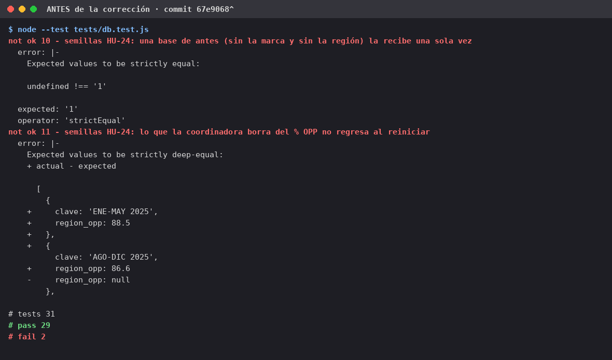
*E4 · antes: lo borrado vuelve a aparecer.*

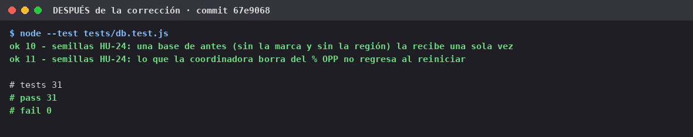
*E4 · después: 31 de 31.*

**E5 · La descarga de ambos Excel fallaba con error 422 después de reimportar contratos (19/11/2026).**

*Síntoma:* si después de registrar una suplencia se reimportaban grupos o contratos, el contrato guardado en el pago del suplente podía dejar de ser suyo y la generación de los dos Excel se detenía. *Acción:* al generar se usa el contrato vigente del suplente, y Reportes muestra el aviso "El contrato guardado ya no es del suplente" con botón *Corregir* que abre el registro (commit `f787b1b`). *Actualización v1.0.2 (26/11):* tras la sesión con la cliente, el contrato del suplente se captura a mano (SIDI propone el de sus grupos y acepta cualquier número), así que este aviso ya no aparece.

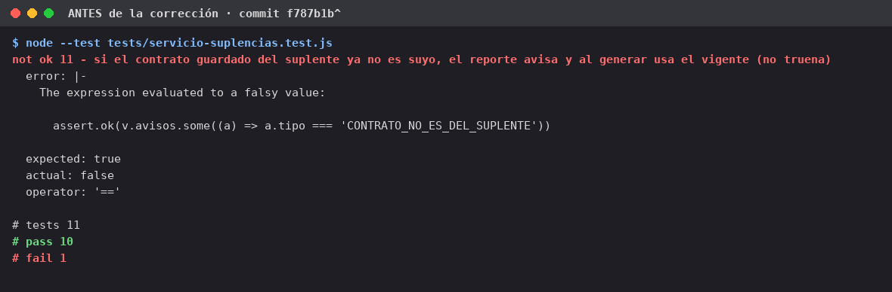
*E5 · antes: no hay aviso y la generación se detiene.*

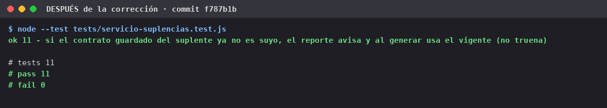
*E5 · después: 11 de 11.*

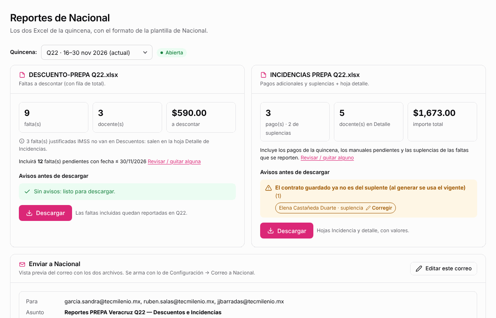
*Figura 11. El mismo caso reproducido en la base de demostración: la descarga sigue disponible y el aviso explica qué corregir.*

**E6 · Con los CV reales se leían 0 títulos y 0 cursos (19/11/2026).**

*Síntoma:* el lector funcionaba con el PDF de ejemplo, pero con los CV institucionales reales no leía títulos, cursos, idiomas ni experiencia. *Causa:* en el formato real las etiquetas vienen partidas en varios renglones o sin dos puntos, e idiomas y experiencia están en las páginas 4 y 5. *Acción:* se leen todas las páginas con texto, el grado sale del encabezado, "Titulo" equivale a Titulado, "Tec Milenio" no cuenta como trabajo externo y "a la fecha" marca la experiencia como vigente (commit `ddd5eb8`, con 3 casos de prueba que imitan el formato real con datos ficticios).

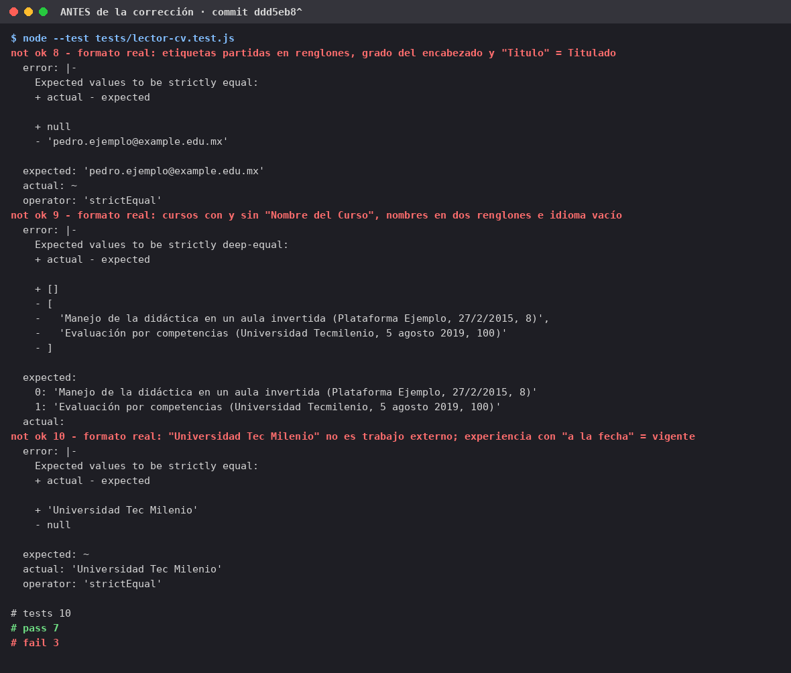
*E6 · antes: 3 pruebas del formato real fallan.*

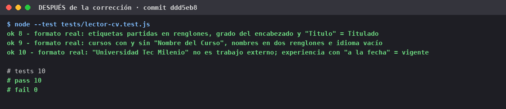
*E6 · después: 10 de 10.*

**E7 · La instalación desde el código falla si la red bloquea el CDN de SheetJS (encontrado el 26/11/2026, abierto).**

*Síntoma:* `npm ci` devuelve 403 al descargar `xlsx` desde `cdn.sheetjs.com`. *Causa:* SheetJS ya no publica sus versiones nuevas en el registro de npm y el proyecto las toma de su CDN. *Impacto:* nulo para la coordinadora, porque el instalador `.exe` ya trae las dependencias; afecta a quien compile desde el código en una red restringida. *Acción propuesta:* guardar el `.tgz` de `xlsx-0.20.3` en el repositorio (carpeta `vendor/`) y apuntar `package.json` a ese archivo (§11).

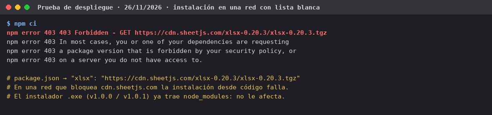
*E7 · instalación en una red con lista blanca.*

**E8 · Falta el ícono de la pestaña (`favicon.ico`) (26/11/2026, abierto, menor).**

El navegador registra un 404 en la consola. No afecta el uso. *Acción propuesta:* agregar `public/favicon.ico` con el logo de SIDI.

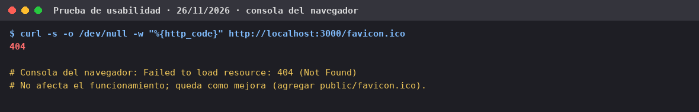
*E8 · consola del navegador.*

**Corregidos en las versiones del instalador (notas en GitHub):** 1.0.1, filtros duplicados en Docentes y vista semanal de horarios recortada; 1.0.2, los cambios pedidos por la cliente en Faltas (§8, restricción 8); 1.0.3 (27/11), la caja del folio IMSS al registrar una falta justificada.

---

## 6. Seguridad, privacidad y uso de datos

**SIDI maneja datos personales de docentes (CURP, nómina, fecha de nacimiento, formación) y opiniones de alumnos; cada uno tiene un control, el riesgo que atiende y su referente, y los controles se verificaron en un entorno de prueba definido.**

*Entorno de prueba:* servidor local con la base de demostración (datos ficticios), 26/11/2026, mismo commit evaluado. *Referentes:* Ley Federal de Protección de Datos Personales en Posesión de los Particulares (LFPDPPP, nueva ley publicada en el DOF el 20/03/2025) y OWASP Top 10:2025.

| Activo o dato protegido | Riesgo | Control en SIDI | Referente | Verificación |
|---|---|---|---|---|
| Toda la base (CURP, nóminas, faltas) | Acceso desde otra computadora de la red sin login | El servidor escucha solo en `127.0.0.1`; abrirlo a la red es una decisión explícita en `.env` | OWASP A01:2025 Broken Access Control | Puerto 3000 ligado a `127.0.0.1` (Figura 12) |
| Datos en consultas | Inyección SQL | Todas las consultas con parámetros (`db.prepare(...).run(?)`) | OWASP A05:2025 Injection | Búsqueda `' OR 1=1 --` devuelve 0 resultados |
| Nombres y textos capturados | XSS (código en un nombre) | Todo dato pintado en HTML pasa por `UI.escape` | OWASP A05:2025 Injection | Docente llamado `` se muestra como texto y no ejecuta nada (Figura 13) |
| Archivos subidos | Ejecutables o archivos enormes | Lista de extensiones por carga y límite de tamaño (15 MB Excel de grupos, 30 MB OPINA, 10 MB por PDF), en memoria | OWASP A06:2025 Insecure Design | `.exe` → 422 `TIPO_ARCHIVO`; 16 MB → `ARCHIVO_GRANDE` |
| La aplicación | Clickjacking, sniffing de tipos | `X-Frame-Options: DENY`, `X-Content-Type-Options: nosniff`, `Referrer-Policy: same-origin`, sin `X-Powered-By` | OWASP A02:2025 Security Misconfiguration | Cabeceras presentes |
| Errores | Mostrar detalles internos | Manejador central: responde un mensaje en español sin pila de llamadas | OWASP A10:2025 Mishandling of Exceptional Conditions | JSON inválido → 400 con mensaje claro |
| Datos del CV | Guardar más de lo necesario | Solo los campos que pide la coordinación; domicilio, teléfono, RFC, estado civil y correo personal **no se guardan** | LFPDPPP, principios de finalidad y proporcionalidad | Revisión del lector y del esquema |
| Observaciones de baja y comentarios de alumnos | Exponerlos en presentaciones | Solo se ven en la ficha; el panel y el resumen ejecutivo usan conteos | LFPDPPP, confidencialidad | Prueba automática: el resumen no incluye comentarios ni observaciones |
| Archivos reales del cliente | Publicarlos en GitHub | `.gitignore` excluye `data/*.db`, `data/cv/`, `data/demo/`; las pruebas usan datos ficticios con CURP inventadas | LFPDPPP, deber de seguridad | Revisión del repositorio: sin archivos reales |
| Credenciales de correo | Robo de contraseñas | SIDI no guarda contraseñas: genera un borrador que se envía desde Outlook | OWASP A07:2025 Authentication Failures | No existen variables `SMTP_*` |

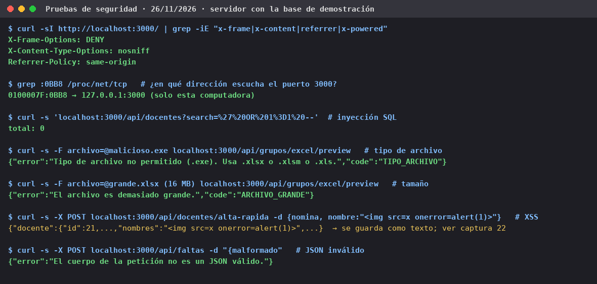
*Figura 12. Pruebas de seguridad ejecutadas contra el servidor. Conclusión: las siete comprobaciones pasaron; los cinco intentos de ataque fueron rechazados o neutralizados.*

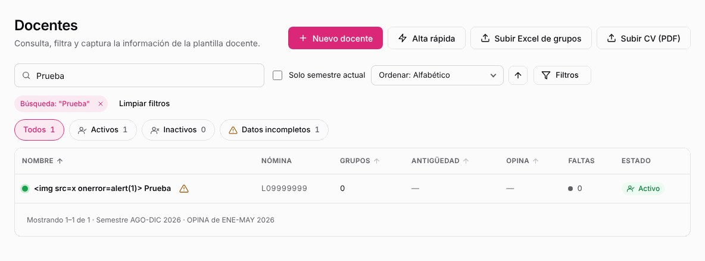
*Figura 13. El nombre con código aparece como texto. Conclusión: el escape de HTML funciona en la tabla de docentes.*

**Riesgo residual (lo que los controles no cubren):**

1. **Sin login, cualquiera con acceso a la computadora abierta ve los datos.** Lo asume la coordinación: cuenta de Windows con contraseña y bloqueo de pantalla.
2. **El respaldo (`/api/respaldo`) es una copia completa con datos personales.** Debe guardarse en una unidad institucional, no compartirse por chat ni correo personal.
3. **Dependencia con vulnerabilidad conocida.** `npm audit` reporta `body-parser 1.20.8` con una vulnerabilidad alta de negación de servicio (GHSA-27r3-jxmh-p828). Como el servidor solo escucha en la propia computadora, explotarla requiere acceso local. Corrección: `npm audit fix` y nueva versión del instalador (§11).
4. **El instalador no está firmado digitalmente**, por lo que Windows SmartScreen muestra una advertencia al instalar.
5. **Proyecto académico.** SIDI se desarrolló con fines académicos y no conserva datos reales fuera de la computadora de la coordinación. Si la institución lo adopta en operación, el uso de los datos de los docentes deberá revisarse contra su aviso de privacidad.

---

## 7. Innovación, impacto y resultados

### 7.1 Línea base: los reportes manuales Q16–Q20

**En los cinco pares de reportes reales que entregó el cliente encontramos 24 inconsistencias, ≈ 4.8 por quincena.** Es una medición sobre archivos reales hecha por el equipo durante el análisis (`context/07_Formatos_Excel.md` §3.3 y §4.4); se omiten nombres de docentes.

| Tipo de inconsistencia | Quincenas | Casos | ¿Afecta dinero? | Control en SIDI | Prueba que lo cubre |
|---|---|---|---|---|---|
| Montos fuera de la tabla de tarifas ($53, $68, $69, $70, $82, $85, $106, $107) | Q17–Q20 | 8 valores distintos (al menos 8) | Sí | El monto sale de la tarifa; si se edita, queda marcado | "monto editable (queda marcado)…" |
| Horas del CRN distintas entre quincenas | Q17 vs Q20 | 2 CRN | Indirecto | Las horas salen del horario del CRN | lector de grupos, horario |
| Horas y monto que no cuadran en el texto | Q17 | 1 | Sí | Texto y monto salen del mismo tipo de clase | "preview: propone los CRN…con monto y comentario" |
| Falta IMSS con cantidad descontada ≠ 0 en *detalle* | Q17, Q19 | 2 | Sí | IMSS = $0 descontado, suplente sí cobra | "hoja detalle con valores (IMSS = 0…)" |
| Cantidad descontada vacía / total que no suma | Q19 | 2 | Sí | Detalle con valores y fila Total calculada | ídem |
| Fecha "a partir de" equivocada | Q16 | 1 | No | Se toma de la fecha de pago de la quincena | "hoja Incidencia con… fecha de pago" |
| Fecha de falta probablemente equivocada en el texto | Q18 | 1 | No | Texto de fechas generado de las faltas | "texto de fechas: un día, consecutivos y sueltos" |
| Fila de total ausente en Descuentos | Q16, Q20 | 2 de 5 | No | Fila de total siempre | "generar Q16: … fila de total" |
| `Tabla17` mal dimensionada | Q16–Q20 | 5 de 5 | No | Se redimensiona al número de filas | "hoja Incidencia con Tabla17 redimensionada" |
| **Total** | | **24** | **13 con dinero** | | |

**Meta medible:** 0 inconsistencias de cálculo y de formato en los reportes generados por SIDI, y reducción del tiempo de preparación por quincena (§7.4).

### 7.2 Por qué esta mejora y no otra

| Alternativa | Qué resolvía | Por qué no se eligió |
|---|---|---|
| Plantilla de Excel con fórmulas y macros | Cálculo de tarifas | No cruza horarios para suplentes, no lee CV ni OPINA y las macros suelen bloquearse en equipos institucionales |
| Sistema web en la nube | Acceso desde cualquier lugar | Exigía login, hospedaje y tratamiento de datos personales fuera de la institución; el cliente pidió no iniciar sesión |
| **SIDI local (elegida)** | Cálculo, validación, suplentes, reportes, consulta y analítica en un solo lugar | Requiere una computadora con Windows y respaldo disciplinado (riesgo introducido, §7.3) |

### 7.3 Riesgo introducido por la mejora y su control

| Riesgo nuevo | Control |
|---|---|
| Un error de SIDI se repetiría en todas las quincenas (antes el error era aislado) | 270 pruebas, avisos antes de descargar y monto editable con marca |
| Pérdida del archivo de base de datos | Respaldo de un archivo con `db.backup`; datos de la app en `%APPDATA%\SIDI\data`, que sobreviven a actualizar o desinstalar |
| Confiar en la lectura automática del CV | Vista previa editable; nada se guarda sin confirmar |

### 7.4 Resultados por esfera

| Esfera | Resultado | ¿Medición o estimación? |
|---|---|---|
| **Técnica** | 270/270 pruebas; búsqueda < 6 ms (p95) frente a la meta de 500 ms; OPINA de 4,000 filas en 0.35 s frente a 10 s; ambos Excel en < 12 ms; 0 vínculos externos | **Medición** (§4.5, §5) |
| **Organizacional** | Las 9 reglas que originaron las 24 inconsistencias de la línea base ahora están automatizadas y probadas; la regla de tarifas coincide con lo cobrado en 41 de 43 CRN | **Medición** sobre pruebas y archivos reales. La reducción de errores en operación real se medirá en Q23–Q24 |
| **Organizacional** | Tiempo de preparación del reporte: ≈ 1 semana por quincena con el proceso manual (según la coordinadora) → con SIDI, la captura de cada falta toma una pantalla y los dos Excel se generan en milisegundos; el tiempo real se cronometrará en Q23. Escenario: si la preparación baja a 1 día hábil, se liberan ≈ 4 días hábiles por quincena, ≈ 96 al año (24 quincenas) | **Estimación**: la línea base es la estimación de la coordinadora y el escenario supone 5 días hábiles de trabajo efectivo por semana; se confirmará con la medición de Q23–Q24 |
| **Social** | Docentes y suplentes reciben descuentos y pagos calculados con la misma regla; las faltas IMSS ya no se reportan como descontadas | **Medición** en pruebas; el efecto sobre reclamaciones no se ha medido |
| **Ambiental** | Corre en la computadora que ya existe: sin servidor ni nube encendidos 24/7 | **Estimación** cualitativa |

**Protocolo para la decisión (Q23 y Q24):** la coordinadora prepara cada reporte como siempre y, en paralelo, con SIDI; anota los minutos de cada proceso y el equipo compara ambos archivos con `scripts/comparar-reportes.js`. Se adopta SIDI si sus reportes no tienen diferencias de cálculo con los correctos y el tiempo es menor.

---

## 8. Riesgos y responsabilidad profesional

**Identificamos ocho restricciones; en cada una cambiamos un requisito, aceptamos un compromiso técnico y dejamos claro quién asume el riesgo.**

| # | Restricción | Requisito modificado | Compromiso aceptado | Quién asume el riesgo |
|---|---|---|---|---|
| 1 | El cliente no quiere iniciar sesión | Sin login; servidor solo en `127.0.0.1` | Quien use la computadora abierta ve todo | Coordinación (resguardo de la PC); el equipo lo documentó |
| 2 | Correo institucional de Outlook sin acceso a TI | Solo borrador `.eml`, no envío directo | Un clic manual por quincena | Coordinadora; se reevalúa con TI (OAuth) |
| 3 | Formato de Nacional no modificable | Generar sobre la plantilla original | Si Nacional cambia el formato hay que actualizar `templates/` | Equipo de mantenimiento |
| 4 | El contrato por CRN no viene en ningún archivo | Plantilla prellenada de contratos (HU-27) y captura al registrar la primera falta | Trabajo inicial de la coordinadora al inicio de semestre | Coordinadora y RH |
| 5 | Datos personales en CV, OPINA y nómina | Minimización de campos; nada real en GitHub | Algunos datos del CV se capturan a mano si se necesitan | Equipo (desarrollo) y coordinación (operación) |
| 6 | Plazo de 15 días hábiles y 7 historias nuevas a mitad del proyecto | Las 3 historias de menor urgencia (13 pts: comparativo del campus, correo y resumen ejecutivo) pasaron a un Sprint 3 de una semana | Lo que se usa cada quincena se entregó primero; lo demás llegó al final | Scrum Master (decidió) y Product Owner (validó con el cliente) |
| 7 | Sebastián (frontend) salió del proyecto | El Scrum Master asumió el frontend además de revisar e integrar cada PR | Más carga en revisión e integración | Scrum Master |
| 8 | Nuevos pedidos de la cliente en la sesión de cierre (26/11): motivo Justificada/No justificada, viaje escolar, siempre 8 horas y contrato del suplente a mano | Versión 1.0.2 después del Sprint 3; la migración 003 reconstruye la tabla de faltas conservando los datos | Cambio de esquema en bases ya instaladas | Scrum Master (implementó) y Product Owner (validó con la cliente) |

**Responsabilidad profesional en la práctica:** ningún archivo real del cliente se subió al repositorio; los datos de demostración son ficticios con CURP inventadas; cada corrección se acompañó de una prueba que demuestra que el error existía; y las limitaciones conocidas (E7, E8, `body-parser`, instalador sin firma, pruebas pendientes con datos reales) se declaran en este reporte en lugar de omitirse.

---

## 9. Despliegue y optimizaciones

**La coordinadora instala SIDI con un `.exe` y no necesita Node.js ni permisos de administrador; para desarrollo basta `npm install` y `npm start`.** El detalle paso a paso está en el *Manual técnico*.

### 9.1 Instalación en la computadora de la coordinación (producción)

1. Descargar el instalador de la versión más reciente (1.0.3) desde *Releases* del repositorio.
2. Ejecutarlo. Si Windows SmartScreen avisa que el instalador no está firmado: *Más información* → *Ejecutar de todas formas*.
3. Abrir SIDI desde el escritorio o el menú Inicio: se abre en su propia ventana, sin navegador ni consola. Los datos se guardan en `%APPDATA%\SIDI\data` y se conservan al actualizar, reinstalar o desinstalar; para abrir esa carpeta: tecla **Alt** → **SIDI** → **Abrir carpeta de datos**.
4. Requisitos: Windows 10 u 11 de 64 bits.

### 9.2 Instalación desde el código (desarrollo)

```bash
git clone https://github.com/CalixtoIsaac/SIDI-Sistema-Integral-de-Informacion-Docente.git
cd SIDI-Sistema-Integral-de-Informacion-Docente
npm install                 # Node.js 20 o superior (recomendado 22 LTS)
cp .env.example .env        # Windows: copy .env.example .env
npm start                   # http://localhost:3000
npm test                    # 270 pruebas
node scripts/demo.js        # base de demostración en data/demo.db
npm run dist                # instalador dist/SIDI-Setup-<versión>.exe (requiere NSIS)
```

### 9.3 Optimizaciones realizadas

| Optimización | Efecto |
|---|---|
| Índices en horarios por día y hora, faltas pendientes (índice parcial), quincena, OPINA por periodo, nombre y estatus del docente | Búsquedas y docentes disponibles en milisegundos |
| SQLite en modo WAL y una sola conexión | Lecturas sin bloquear escrituras; respaldo consistente con `db.backup` |
| Escrituras relacionadas en una transacción (falta + suplencia + incidencia) | Si algo falla no quedan registros a medias |
| Excel generado editando el XML de la plantilla; se borra `calcChain.xml` y se marca `fullCalcOnLoad` | Archivos de Nacional en < 12 ms, sin avisos de reparación ni de vínculos |
| Tabla de docentes paginada en el servidor según el alto de la ventana | Se transfiere solo la página visible |
| Archivos subidos en memoria, con límites de tamaño | No quedan archivos temporales con datos personales |
| Frontend sin frameworks ni paso de compilación; gráficas propias | Sin dependencias de internet; carga inmediata |
| `theme.js` aplica el tema antes de pintar | Sin parpadeo al cambiar a modo oscuro |
| Migraciones versionadas (`schema_migrations`) | Actualizar el instalador no borra datos (la 003 reconstruye `faltas` conservando ids y suplencias) |
| App de escritorio en un puerto libre y una sola instancia | No choca con otro programa que use el puerto 3000; abrir SIDI dos veces enfoca la ventana existente |

---

## 10. Reflexión: lecciones aprendidas

### 10.1 Técnicas

- **Los archivos reales mandan.** El lector de CV pasaba sus pruebas con el ejemplo y falló con el formato institucional (E6). Desde entonces cada lector se prueba con una copia ficticia que imita los defectos del original.
- **Una prueba por cada error.** Las correcciones E2 a E6 llegaron con su prueba de regresión; así pudimos reproducir hoy cada error y mostrarlo en este reporte.
- **Respetar un formato ajeno es un requisito técnico.** Editar el XML de la plantilla fue más laborioso que generar un Excel nuevo, pero es lo que garantiza que Nacional reciba exactamente lo que espera.
- **Pensar en el sistema operativo del cliente.** Saltos de línea de Windows (E1), carpetas sincronizadas con OneDrive durante `git pull` y el instalador sin Node fueron problemas que no aparecían en la computadora de desarrollo.

### 10.2 Metodológicas

- **Mostrar pronto al cliente cambia el backlog para bien.** La revisión del 29/10 aprobó el diseño y agregó 7 historias (de 108 a 134 puntos); el Scrum Master las ordenó para que las de menor riesgo entraran a los Sprints 1 y 2 y el resto a un Sprint 3.
- **Un solo responsable de fusionar da orden, pero concentra carga.** Con 45 PR revisados por una persona, apilar ramas del mismo día obligó a rehacer cadenas de PR contra `develop`; aprendimos a abrir PR pequeños y a declarar sus dependencias en la descripción.
- **La definición de terminado debe incluir el dato real.** Dos criterios (comparar con Q16–Q20 y probar el `.eml` en el Outlook de la coordinadora) dependen de la computadora del cliente y quedaron para el cierre; debieron agendarse desde el inicio del sprint.
- **Documentar primero permite absorber cambios en el equipo.** Como todo estaba documentado en `context/` (requerimientos, modelo de datos, API y tareas por persona), el Scrum Master pudo absorber el frontend cuando salió un integrante, sin perder historias.

### 10.3 Cómo mejora la eficiencia operativa de la coordinación

SIDI ataca los tres puntos donde se iba el tiempo y aparecían errores: **calcular** (tarifas, horas, días, IMSS), **buscar suplente** (cruce de horarios de todos los docentes) y **llenar formatos** (dos Excel con formato fijo y su conciliación). Además deja a la coordinación datos que antes no tenía a la mano: ranking OPINA completo, inasistencias por semestre, plantilla por semestre y un resumen ejecutivo listo para la directiva. El ahorro de tiempo se confirmará con la medición propuesta en §7.4.

---

## 11. Áreas de mejora y siguientes iteraciones

| Prioridad | Mejora | Por qué |
|---|---|---|
| Alta | Ejecutar la comparación con Q16–Q20 y la prueba del `.eml` en el Outlook de la coordinadora | Son los dos criterios de aceptación pendientes con datos reales |
| Alta | `npm audit fix` (body-parser ≥ 1.20.9), quitar `bcryptjs` y `jsonwebtoken` (sin uso) y renombrar el paquete a `sidi` | Cierra la vulnerabilidad conocida y reduce la superficie de dependencias |
| Alta | Selector de "semestre actual" en Configuración | Hoy se marca con `PUT /api/periodos/:id`; la coordinadora lo necesita al inicio de cada semestre |
| Alta | Guardar `xlsx-0.20.3.tgz` en el repositorio | Instalación desde el código sin depender del CDN (E7) |
| Media | Botón "Descargar respaldo" con aviso de datos personales, y recordatorio periódico de respaldo | Hoy se copia la carpeta de datos (Alt → SIDI → Abrir carpeta de datos) o se usa `/api/respaldo` en desarrollo |
| Media | Firmar el instalador | Quitar la advertencia de SmartScreen |
| Media | Migración `004` que borre las tablas `usuarios` y `notas` heredadas de la plantilla | Limpieza del esquema en bases existentes |
| Media | Recuperar el selector de columnas de la tabla de docentes (HU-03) como opción | Se sustituyó por la ficha completa en el rediseño |
| Baja | `favicon.ico` (E8) | Pulido |
| Expansión | Envío directo con Microsoft Graph si TI lo autoriza | Elimina el clic manual del correo |
| Expansión | Varios usuarios (directiva en modo lectura) con inicio de sesión y servidor en red | Solo si la coordinación lo pide; implicaría login y migrar a un servidor de BD |
| Expansión | Más gráficas del catálogo del resumen ejecutivo y alertas automáticas (docente con 3+ faltas, OPINA < 70 %) | Ya existen los datos |
| Expansión | Importar el reporte de contratos de RH si se crea | Elimina la captura manual de contratos |

---

## 12. Referencias

Cámara de Diputados del H. Congreso de la Unión. (2025, 20 de marzo). *Ley Federal de Protección de Datos Personales en Posesión de los Particulares*. Diario Oficial de la Federación. https://www.diputados.gob.mx/LeyesBiblio/pdf/LFPDPPP.pdf

Galeana Medrano, C. I., Hernández Garrido, M., García Duarte, U. A., Cecilio Rascón, S., y Huesca Ramírez, S. (2026). *SIDI: Sistema Integral de Información Docente* [Software y documentación]. GitHub. https://github.com/CalixtoIsaac/SIDI-Sistema-Integral-de-Informacion-Docente

Microsoft Exchange Team. (2026, 27 de enero). *Updated Exchange Online SMTP AUTH Basic Authentication deprecation timeline*. Microsoft Tech Community. https://techcommunity.microsoft.com/blog/exchange/updated-exchange-online-smtp-auth-basic-authentication-deprecation-timeline/4489835

OWASP Foundation. (2025a). *A05:2025 Injection*. https://owasp.org/Top10/2025/A05_2025-Injection/

OWASP Foundation. (2025b). *OWASP Top 10:2025*. https://owasp.org/Top10/2025/

---

## Anexo A. Cumplimiento de las rúbricas

**Rúbrica de la Feria de Ingenierías (jurado)**

| Criterio | Peso | Dónde se cumple |
|---|---|---|
| Vinculación con materia o certificado | 10 % | Portada y §1 (Metodologías Ágiles) |
| Fundamentación cuantitativa | 20 % | §4: tres decisiones con alternativas, unidades, supuestos, incertidumbre y límites; §4.5 metas vs. mediciones |
| Innovación y mejora propuesta | 15 % | §7.1 línea base (24 inconsistencias) y meta; §7.2 dos alternativas; §7.3 riesgo introducido y control |
| Riesgos y responsabilidad profesional | 15 % | §8: ocho restricciones con requisito, compromiso y responsable |
| Impacto respaldado por resultados | 20 % | §7.4: dato técnico, organizacional y social/ambiental, con medición o estimación declarada |
| Seguridad, privacidad y uso de datos | 10 % | §6: activo → riesgo → control → referente → verificación, y riesgo residual |
| Comunicación visual de resultados | 10 % | Cada figura lleva su conclusión; secuencia problema → solución → evidencia → decisión; decisión solicitada en el Resumen y §7.4 |

**Rúbrica de entrega final (PDF)**

| Criterio | Dónde se cumple |
|---|---|
| 1. Prototipo funcional | §3 (27 historias en 9 vistas), §5 (270 pruebas) y *Manual de usuario* |
| 2. Interfaz de usuario | §3.3 decisiones de UI/UX justificadas; capturas en el *Manual de usuario* |
| 3. Integración y manejo de datos | §2 modelo de datos, §4.1, §9.3 transacciones e índices |
| 4. Pruebas y validación | §5 (resultados, 8 errores con capturas y acción), §6 (seguridad), revisión de usabilidad |
| 5. Presentación y justificación | Este reporte (§3.3 y §4) y la presentación del prototipo |
